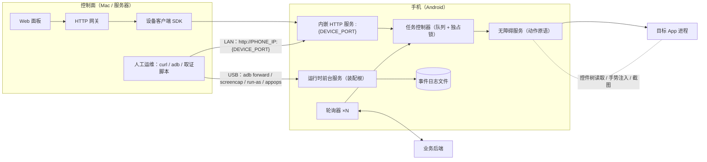
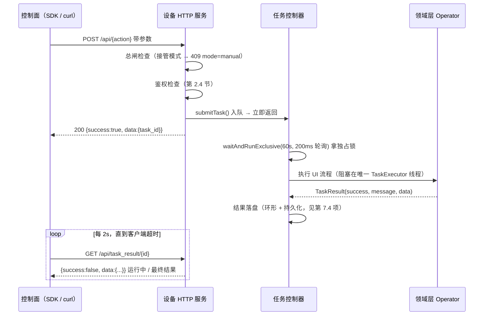

# Android RPA App 通用框架规范与实施蓝图

> **自洽文档**：本文不依赖任何外部仓库即可实施。所有可直接落地的实现骨架在**第 9 章 参考实现**，所有参数化占位符在**第 10 章 占位符字典**。第 11 章溯源索引仅是原项目证据映射，删除不影响使用。
>
> **适用对象**：要基于 Android AccessibilityService 做一个自动化任意目标 App 的 RPA App（换目标 App、换任务类型都适用）。
> **来源**：抽象自一个生产运行的企业微信 RPA（无障碍 + 内嵌 HTTP + 前台服务 + 多轮询器），已剥离业务语义。
> **不适用**：不需要长期无人值守、不需要远程控制实机 UI 的场景。

---

## 目录

- 第 1 章 分层架构与拓扑
- 第 2 章 基础设施规格（逐子系统）
- 第 3 章 UI 自动化引擎规格
- 第 4 章 任务编排规格
- 第 5 章 目标 App 适配方法论
- 第 6 章 新项目落地手册
- 第 7 章 反模式与必避的坑
- 第 8 章 立项决策清单
- 第 9 章 参考实现（可粘贴代码）
- 第 10 章 占位符字典
- 第 11 章 溯源索引（可选）

---

## 1. 分层架构与拓扑

### 1.1 六层模型

| 层 | 名称 | 职责 | 与目标 App 的关系 | 换目标 App / 换任务时 |
|---|---|---|---|---|
| L0 | 设备接入层 | PC/服务端如何连上手机、如何判活 | 无关 | **完全复用** |
| L1 | 运行时层 | 常驻不掉、屏幕不熄、权限齐、可被唤醒 | 无关 | **完全复用** |
| L2 | 能力层（动作原语） | 查找/点击/输入/滑动/返回/截图/导出控件树 | 弱相关（仅包名白名单） | **复用，改白名单** |
| L3 | 领域层（页面语义） | 目标 App 的页面 ID、导航链、业务流程、文案阶梯 | 强相关 | **全部重写** |
| L4 | 编排层 | 任务队列、互斥、轮询、持久化状态、重试、人工接管 | 骨架无关，业务态相关 | **骨架复用，业务态重写** |
| L5 | 控制面 | 网关、设备注册表、面板、脚本、取证工具链 | 无关（配置驱动） | **结构复用，配置重填** |

**设计不变式**：L3 是唯一允许出现目标 App 知识的层。L2 及以下禁止出现任何目标 App 的 resource-id、Activity 类名、中文文案。这条边界是"换 App 只改一处"的前提，实操中最容易被破坏。

### 1.2 拓扑



两条链路的性质不同，实施时不要混淆：

- **执行链（自动）**：控制面 → 设备 HTTP → 任务队列 → 无障碍 → 目标 App。运行期**不依赖 USB**。
- **运维链（人工）**：ADB。只用于安装、配权限、取证、救砖。**任何业务动作都不许走 ADB**，否则拔线即断流。

### 1.3 一次远程动作的时序（同步语义、异步实现）



**为什么必须异步**：单条 UI 流程耗时 5~120 秒不等，且不可预测（目标 App 卡顿、弹窗、列表刷新慢）。同步返回会让 HTTP 连接、网关、上层脚本的超时全部失真，还容易出现"客户端超时放弃、手机仍在操作、双方状态不一致"。

允许同步的唯一例外：确定短于 2 秒的动作（如读取一个已在前台的页面状态），且必须用**非阻塞抢锁**，抢不到立即 `409 {busy_owner}`，绝不排队。

---

## 2. 基础设施规格

每个子系统按 **需求 → 规格 → 约束/踩坑** 三段给出。可直接抄的实现见第 9 章对应小节。

### 2.1 L0 设备接入：四条通道

| 编号 | 通道 | 建立命令 | 用途 | 失效条件 |
|---|---|---|---|---|
| T1 | 局域网直连 | `PHONE_IP=$(adb shell ip -4 addr show wlan0 \| grep -oP '(?<=inet\s)\d+(\.\d+)+')`；`curl http://$PHONE_IP:<DEVICE_PORT>/api/status` | 日常运行首选，装完即免线 | WiFi/路由器变更、DHCP 换址 |
| T2 | ADB 端口转发 | `adb forward tcp:<HOST_PORT> tcp:<DEVICE_PORT>`；`curl http://127.0.0.1:<HOST_PORT>/api/status` | 所有取证脚本、IP 不稳时 | 拔 USB |
| T3 | 纯 ADB | `screencap`、`input tap/swipe/keyevent`、`am start/force-stop`、`dumpsys`、`appops`、`exec-out run-as` | 兜底：App 崩了、服务起不来、装机配权限 | 拔 USB；**禁止 `uiautomator dump`** |
| T4 | 网关代理 | 上层只调 `http://<GW_HOST>:<GW_PORT>/api/<app>/...`，网关内部调设备 | 多人共用、多设备、无本地环境 | 网关挂 |

规格要求：

1. 设备侧端口 `<DEVICE_PORT>` 固定且写进配置，不由运行时分配。
2. 主机侧转发端口按规则派生：`<HOST_PORT> = 1<DEVICE_PORT>`（如 9527 → 19527）。多设备各占一个 host 端口，维护 `serial → host_port` 映射表。
3. **单一健康端点**：`GET /api/status` 同时充当 liveness 与 readiness。判定顺序固定：`httpServerRunning` → `accessibilityEnabled` → `busy` → `taskQueueSize` → `currentApp/currentPage`。前两项任一为 false 即视为不可用，不要试图下发任务。
4. 控制面客户端**必须绕过系统代理**：Mac 常开本地科学代理会把发往局域网/内网 IP 的请求带走并超时。Python 用 `session.trust_env = False`；curl 用 `--noproxy '*'`；Gradle 侧不得把代理地址提交进仓库。
5. 可选增强（原项目未做，多设备时应补）：无线 ADB（`adb pair`/`adb connect`）用于免线运维；设备侧截图端点替代 `adb screencap`（见第 7.5 项）。

### 2.2 L1 运行时装配根

一个进程内需要一个**唯一装配根**，负责按序创建并启动所有运行时对象。规格：

```
onCreate():
  1. 初始化日志器（必须最先，后续失败要有日志可查）
  2. 加载配置存储
  3. 初始化通知渠道与提醒能力
  4. 创建领域层 Operator（单实例）
  5. 创建各状态 Store
  6. 创建任务控制器
  7. 创建 N 个轮询器（注入：任务控制器 + Operator + Store + 配置）
  8. 创建前台通知渠道 → startForeground(<NOTIFICATION_ID>, notif)
  9. 启动屏幕保活
  10. startRuntimeIfNeeded()
```

约束：

- **必须是前台服务**（`foregroundServiceType` 按真实用途选择，Android 14+ 会校验类型与权限成对出现）。类型选择见第 2.7 节权限表。
- `startRuntimeIfNeeded()` 用 `@Synchronized` + "server 引用非空即已启动"做幂等；启动异常必须 `isRunning=false; stopSelf()`，不允许半启动状态。
- `onStartCommand` 返回 `START_STICKY`；`onDestroy` 逆序停：屏幕保活 → 各轮询器 → HTTP → 任务控制器。
- **自愈三源**（缺一不可，实测系统会以多种方式杀进程）：
  1. 启动 Activity 的 `onCreate/onResume` 检测 `!isRunning` 则拉起；
  2. 状态刷新循环检测"无障碍已连但 HTTP 未跑"则补拉起；
  3. `START_STICKY` + 厂商自启动白名单。
- 强烈建议补强（原项目缺失）：`BootReceiver`（声明了 `RECEIVE_BOOT_COMPLETED` 却没实现 Receiver 等于没声明）+ 周期 watchdog（检测无障碍句柄为空时告警/重试）。

### 2.3 L2 无障碍服务的注册与交接

配置模板（完整文件在第 9.2 节）：

| 属性 | 取值 | 作用与后果 |
|---|---|---|
| `accessibilityEventTypes` | `typeWindowStateChanged\|typeWindowContentChanged\|typeNotificationStateChanged` | 少了 `WindowStateChanged` 就拿不到前台页面名，页面判定退化为纯猜 |
| `accessibilityFlags` | `flagDefault\|flagIncludeNotImportantViews\|flagReportViewIds\|flagRetrieveInteractiveWindows` | `flagReportViewIds` 决定能否读 `viewIdResourceName`（ID 登记表的前提）；`flagRetrieveInteractiveWindows` 决定能否枚举 `windows`（Popup/Dialog 定位的前提） |
| `canRetrieveWindowContent` | true | 读树 |
| `canPerformGestures` | true | 坐标点击/滑动（Android 7+） |
| `canTakeScreenshot` | true | 服务内截图（Android 11+），低版本必须有空返回兜底分支 |
| `notificationTimeout` | 100 | 事件合并窗口 |
| `settingsActivity` | 你的启动 Activity | 系统设置里能跳回你的引导页 |
| `packageNames` | **不要写 XML** | 见下 |

三条硬约束（都来自实际故障）：

1. **`packageNames` 在 `onServiceConnected` 里动态设置**，且必须一次性包含：目标 App 包名、`android`、系统分享解析器包名、`com.android.systemui`、厂商安全中心包名。Android 14+ 与跨 App 分享场景下，未声明的窗口拿不到内容——表现为"同一个函数在同一台手机上时好时坏"。
2. **不要设 `ACCESSIBILITY_FLAG_KEEP_TOUCH_MODE`/隐藏软键盘相关 flag**：部分国产 ROM（MIUI 实测）会把 EditText 从控件树**整体移除**而非仅视觉隐藏，导致按 id 找不到输入框。宁可让键盘挡着，也不要碰这个开关。
3. **句柄交接用 `@Volatile companion object var instance`**：`onServiceConnected` 赋值、`onDestroy` 置 null，其余组件全部通过该单例访问原语。副作用是"服务未连上时所有原语静默 no-op"。因此**每条执行入口必须先取句柄并显式报错**，返回可读消息如 `无障碍服务未连接，请在系统设置开启`，不要让流程静默失败。

动作原语清单（这些 API 与目标 App 无关，第 9.3 节给实现）：

| 能力 | Android API | 备注 |
|---|---|---|
| 取活动窗口根 | `rootInActiveWindow` | 包 try/catch，返回 null |
| 按 id 查找 | `findAccessibilityNodeInfosByViewId` | 需 `flagReportViewIds` |
| 跨窗口查找 | 遍历 `windows[*].root` 再查 | Popup/Dialog 必需，见第 3.3 节 |
| 按文本查找 | `findAccessibilityNodeInfosByText` | 子串/label 匹配，需精确匹配再后过滤 |
| 自定义遍历 | 手写 `getChild/childCount` DFS | 必须带节点数与深度上限 |
| 语义点击 | `performAction(ACTION_CLICK)` | 不可点击则沿 `parent` 上溯 |
| 坐标点击/长按 | `dispatchGesture(GestureDescription)` | 长按 duration≈1000ms，点击≈100ms |
| 滑动 | `dispatchGesture` + `Path.moveTo/lineTo` | duration≈500ms |
| 列表滚动 | `ACTION_SCROLL_FORWARD/BACKWARD` | 失败退回 `swipe` |
| 文本写入 | `ACTION_SET_TEXT` + `ACTION_ARGUMENT_SET_TEXT_CHARSEQUENCE` | 首选，UTF-8 直传，中文可用 |
| 文本写入兜底 | 剪贴板 + `ACTION_FOCUS` → `0x20000`(SELECT_ALL) → `ACTION_PASTE` | 部分搜索框无 EditText，只能走焦点粘贴 |
| 富文本追加 | 原 `CharSequence` 拷入 `SpannableStringBuilder` 再一次 `ACTION_SET_TEXT` | 保住目标 App 的内部 span（提及/表情） |
| 全局键 | `performGlobalAction(BACK/HOME/RECENTS/NOTIFICATIONS)` | 返回键有防护要求，见第 3.6 节 |
| 服务内截图 | `takeScreenshot(Display.DEFAULT_DISPLAY, executor, callback)` + `Bitmap.wrapHardwareBuffer` | SDK≥R，用 `CountDownLatch` 设超时（≈1200ms） |
| 几何 | `getBoundsInScreen(Rect)`、`isVisibleToUser` | 中心点用于坐标兜底 |

### 2.4 命令通道：设备端 HTTP 契约

**选型**：内嵌 HTTP 用 NanoHTTPD 2.3.1 量级的单文件级库（无框架、无注解扫描、包体可忽略）。JSON 用平台 `org.json`，出站用 `HttpURLConnection` —— 移动端刻意保持零重依赖，可减少 R8/反射面。若团队更熟协程，可换 Ktor + kotlinx.serialization，但**API 契约不变**。

**绑定与安全（必须做决策，见第 7.1 项）**：默认绑全网卡以便 LAN 直连；但必须同时具备
- 设备令牌鉴权（每个写操作校验 `Authorization: Bearer <DEVICE_TOKEN>`；令牌由配置下发或首次启动生成后从 `/api/status` 之外渠道取回）；
- CORS 白名单（不要 `*`）；
- 可选：仅绑 `127.0.0.1` + 强制走 `adb forward`（安全性最高，代价是必须插线）。

**响应信封（唯一形态）**：

```json
{ "success": true,  "data": { }, "message": "" }
{ "success": false, "message": "人类可读失败原因" }
```

- 失败用 HTTP 码表达类别：`400` 参数错、`401` 未鉴权、`404` 路由不存在、`409` 忙或被总闸拒绝、`500` 内部异常。
- **不要用** `{code, msg}` 型自定义码信封：会让网关与设备各说一套，且 `code` 语义与 HTTP 码冲突。
- 字段命名 camelCase；**入参**为兼容历史客户端可同时接受 snake_case 与 camelCase 双读（`body["imageUrl"] ?: body["image_url"]`），但**出参只出一种**。

**端点基线（新项目最小集）**：

| 方法 | 路径 | 语义 | 说明 |
|---|---|---|---|
| GET | `/api/status` | 健康与状态 | 见下方 Schema |
| GET | `/api/dump_ui` | 导出控件树文本 | 调试主力；`data` 为字符串 |
| GET | `/api/logs?level=&limit=` | 取最近日志 | 默认最新 120 条 |
| POST | `/api/<action>` ×N | 业务动作 | 一律异步入队，返 `task_id` |
| GET | `/api/task_result/{id}` | 取任务结果 | 未完成时 `data.success == null` |
| GET | `/api/task_queue_size` | 队列深度 | 含 `busy` |
| POST | `/api/config` | 读写配置（含总闸 `enabled`） | 需鉴权，**响应不得回显密钥** |
| GET | `/api/business_state` | 只读业务快照 | 队列/进度/待人工列表 |

`GET /api/status` 完整 Schema：

```json
{
  "success": true,
  "data": {
    "accessibilityEnabled": true,
    "httpServerRunning": true,
    "currentApp": "<目标 App 包名>",
    "currentPage": "<Activity 类名>",
    "taskQueueSize": 0,
    "mode": "ai",
    "versionName": "1.0.0",
    "devicePort": 9527
  },
  "busy": false,
  "busy_owner": ""
}
```

**任务 ID**：短 ID 即可（UUID 前 8 位），但要接受碰撞概率上升——结果表按 `id` upsert 并在返回值里回显完整 `task_id`，网关侧按 `device_id + task_id` 组合作唯一键。

**鉴权/总闸的顺序**：先总闸（`409 mode=manual`）再路由再鉴权，还是先鉴权再总闸？规格固定为**鉴权最先**（否则未授权方能通过 409/200 差异探测开关状态），总闸次之，路由最后。

### 2.5 L4 并发与互斥：一把设备独占锁

RPA 的根本约束：**一台手机同一时刻只能有一条 UI 操作流**。锁必须暴露"谁在占用"。

契约（实现见第 9.5 节）：

```kotlin
fun tryRunExclusive(owner: String, block: () -> Unit): Boolean
// 不等待。锁被占则立即返回 false。轮询器/短动作专用：忙就跳过本轮，绝不排队。

fun waitAndRunExclusive(owner: String, timeoutMs: Long = 60_000, block: () -> TaskResult): TaskResult
// 200ms 自旋等待。HTTP 任务队列专用：超时报「等待设备空闲超时，当前占用: <owner>」。

val isBusy: Boolean
val busyOwner: String   // 直接进 /api/status.busy_owner
```

规格：

- `owner` 命名规范：`<来源>:<标识>`，如 `task:<id>:<type>`、`poller:<name>`、`sync:<动作>`。这是唯一可观测性来源，不许传空。
- 每个轮询器自己一个 `newSingleThreadScheduledExecutor`，但所有碰屏幕的工作汇入同一把锁 ⇒ 屏幕串行。
- **忙时策略二选一并写死在轮询器基类**：跳过（默认）或等待。混用会导致"某个轮询器长期占锁饿死其他轮询器"。
- 无硬取消：靠协作式中止——每个阶段边界复查 `Thread.currentThread().isInterrupted` 与总闸配置。长流程必须显式插入取消点。
- 结果表：内存环形 + **必须落盘**（原项目仅内存，进程重启后轮询静默失败，见第 7.4 项），条目状态机 `pending/running/done/lost`。

### 2.6 日志子系统

一个进程内日志器承担四件事：App 内实时展示、落盘、HTTP 取回、错误定位。规格（实现第 9.4 节）：

| 项 | 规格 |
|---|---|
| 级别 | `DEBUG / INFO / WARN / ERROR / NET`（`NET` 独立一级，出站调用与入站请求一眼可分） |
| 条目字段 | `id, time, level, tag, message, detail, method, url, status, requestBody, responseBody, durationMs, error` |
| 时间戳 | **`yyyy-MM-dd HH:mm:ss.SSS`**（原项目只有 `HH:mm:ss`，跨天日志无法定位——新项目别再犯） |
| 内存 | 环形，默认 1500 条，新在前，写入加同步 |
| 字段截断 | 单字段上限（原项目 80 000 字符，建议降到 4 000 并把全文交给 logcat），截断处标注 |
| 落盘 | `<filesDir>/<日志文件名>.json`；**必须做**：追加或轮转（按大小/天数），不要整文件重写 |
| 写盘线程 | 单线程 + 去抖合并（引用比较快照，只写最新），磁盘异常吞掉并继续，日志绝不可反向影响主链路 |
| 取回 | ① `GET /api/logs`（主路）② `adb exec-out run-as <APP_ID> cat files/<日志文件>` ③ `adb logcat -s <Tag>...` |
| **脱敏** | **写入时脱敏，不依赖外部纪律**。密钥类字段名白名单反转 + URL query `key/token` + `Bearer` 一律替换 `***REDACTED***` |

日志条目 Schema：

```json
{
  "id": 1234,
  "time": "2026-10-20 14:03:22.517",
  "level": "NET",
  "tag": "DeviceHttpServer",
  "message": "设备 HTTP API 请求: POST /api/<action>",
  "detail": "",
  "method": "POST",
  "url": "/api/<action>",
  "status": 200,
  "requestBody": "{\"contact\":\"<已按策略脱敏>\"}",
  "responseBody": "",
  "durationMs": 8412,
  "error": ""
}
```

**必须承认的风险**：RPA 日志天然含用户内容与令牌。因此
- 日志目录不得提交进仓库；
- 外发前必须过脱敏；
- 不要把敏感配置回显在 App 界面（很多 RPA 引导页把配置塞进 EditText，屏幕分享即泄密）。

### 2.7 权限与环境准备

**A. manifest 声明即可**

| 权限 | 用途 | 备注 |
|---|---|---|
| `INTERNET` | 内嵌 HTTP + 调后端 | |
| `WAKE_LOCK` | 屏幕保活 | |
| `FOREGROUND_SERVICE` + 类型权限 | 常驻服务 | Android 14+ 类型与权限成对（`dataSync`/`specialUse` 等） |
| `POST_NOTIFICATIONS` | 接管提醒 | 13+ 需运行时申请 |
| `VIBRATE` | 告警震动 | |
| `READ_MEDIA_IMAGES`（33+）/`READ_EXTERNAL_STORAGE` | 读目标 App 保存的文件 | 仅"需要读目标 App 落盘产物"时申请 |
| `RECEIVE_BOOT_COMPLETED` | 开机自启 | **必须配套 BootReceiver，否则等于没声明** |
| `QUERY_ALL_PACKAGES` 或 `<queries>` | 检测目标 App 是否安装/前台 | 上架合规优先用 `<queries>` 指定包名 |

**B. 只能跳设置页、人工点击**

| 项 | 检测方式 | 引导方式 |
|---|---|---|
| 无障碍服务 | **唯一可靠检测：`AccessibilityService.instance != null`**（无法用 API 查询开启状态） | `startActivity(Settings.ACTION_ACCESSIBILITY_SETTINGS)` |
| 悬浮窗 | `Settings.canDrawOverlays(context)` | `ACTION_MANAGE_OVERLAY_PERMISSION?package=<APP_ID>`，失败退到应用详情页 |
| 通知 | `NotificationManagerCompat.areNotificationsEnabled()` | `ACTION_APP_NOTIFICATION_SETTINGS` |
| 电池优化白名单 | `powerManager.isIgnoringBatteryOptimizations(<APP_ID>)` | `ACTION_REQUEST_IGNORE_BATTERY_OPTIMIZATIONS`（原项目完全没做，长期无人值守必做） |

**C. 厂商 ROM 私有开关（读不到状态，只能"人点 + ADB 校验"）**

典型必需项（MIUI/HyperOS 实测）：自启动、后台弹出界面。App 侧只能弹说明框 + "我已开启"按钮把结果记进 SharedPreferences（**这只是记账，不代表真的开了**）。真实校验只能靠 ADB：

```bash
adb shell appops get <APP_ID> 10021          # 后台弹出界面，须含 allow
adb shell appops set  <APP_ID> 10021 allow
```

深链候选表（按顺序尝试，全失败落到应用详情页）：`<厂商安全中心>.AutoStartManagementActivity` → `PermissionsEditorActivity` → `AppPermissionsEditorActivity` → `miui.intent.action.APP_PERM_EDITOR`（带 `extra_pkgname`）→ `Settings.ACTION_APPLICATION_DETAILS_SETTINGS`。ColorOS/OneUI/EMUI 各有一套，新项目按目标机型替换此表。

**关键厂商坑（必须预算）**：MIUI 在 APK 覆盖安装后会**异步回滚**"后台弹出界面"的 appop（它先按自己的权限库同步一遍，再覆盖你刚设的值）。对策：`set → sleep 5 → set → sleep 2 → get 校验 → sleep 2 → get 再校验`，两次校验任一失败即退出并提示人工处理。实现见第 9.10 节。

### 2.8 屏幕保活

**不要用 `FLAG_KEEP_SCREEN_ON`**：它要求你自己的窗口在前台，而 RPA 让目标 App 占着前台。

规格（实现第 9.8 节）：
- `PowerManager.SCREEN_DIM_WAKE_LOCK`，`setReferenceCounted(false)`，tag `<APP_ID>:rpa-screen-awake`，**不设超时**（需 `@SuppressLint("WakelockTimeout")`，因为它跟随前台服务生命周期）。
- 只在 `powerManager.isInteractive == true` 时 acquire；注册 `ACTION_SCREEN_ON/ACTION_SCREEN_OFF` 广播驱动 acquire/release（Android 13+ 用 `RECEIVER_NOT_EXPORTED`）。
- 语义边界：该锁**不会唤醒或解锁已息屏设备**，用户按电源键息屏会被尊重；用户重新亮屏后锁自动恢复。这个行为是期望的（避免半夜强行点亮）。
- 所有异常只记日志、继续运行，保活失败绝不能阻断主链路。
- 运维侧配合：`adb shell settings put global stay_on_while_plugged_in 7`（充电时常亮）。生产托管机建议"常驻充电 + 该设置"，屏幕保活作为第二道。

### 2.9 状态与配置持久化

分三类，**不要塞进同一个存储**：

| 类别 | 内容 | 建议载体 | 关键要求 |
|---|---|---|---|
| 配置 | 后端地址、令牌、开关、账号标识 | 明文走 prefs、**密钥走 `EncryptedSharedPreferences`** | 配置项要有默认值与生效优先级说明 |
| 队列/进度 | 待执行任务、分阶段进度、失败计数 | Room（数据量大）或 prefs 存 JSON | **进度必须分阶段落盘** |
| 结果 | 任务执行结果 | 落盘（第 7.4 项） | 带 TTL 与状态机 |

断点续跑模型（RPA 的核心，照此设计）：一次 UI 流程可能半途崩在某个页面上，所以队列条目要带**阶段标记**（例：`text_sent` / `images_partially_done` / `ack_pushed`），重启后按阶段续跑而不是整体重做；配套三件套：
1. 漏跑的 `dueAt` 重置为 now（不要补跑历史时间点的任务，会造成突然爆发）；
2. 终态失败落 tombstone + 冷却恢复（避免死循环重试）；
3. 半途动作的专用恢复函数 + 纯判定门（决定"是否需要先回到主页面清理中断态"）。

### 2.10 通知与人工接管提醒

无人值守的 RPA 需要"把人的注意力叫回来"。规格：
- 一个 `IMPORTANCE_HIGH` + 自定义震动模式的 alarm 渠道（与常驻前台服务的 LOW 渠道**分开**）；
- 通知带 `PRIORITY_HIGH`/`CATEGORY_ALARM`，PendingIntent 直接拉起目标 App 的对应会话（让接手的人一点就到现场）；
- 语音兜底链（重要场景才需要，逐级降级）：服务端 TTS → 本地缓存音频 → `MediaPlayer` → 系统 `TextToSpeech` → 系统铃声。注意 `MediaPlayer`/`TTS` 必须在主线程 Handler post；
- 待人工列表要持久化 pending/done，并支持"超时未处理"二次提醒候选。

### 2.11 构建、签名、安装

版本矩阵（一个经过生产验证的组合，新项目可整体沿用再单点升级）：Gradle 8.4 + AGP 8.2.2 + Kotlin 1.9.22 + compileSdk/targetSdk 36 + **minSdk 24**（`dispatchGesture` 下限）+ Java/Kotlin target 1.8。

必须注意：
1. **`namespace` 与 `applicationId` 若不同，外部工具链只认 `applicationId`**。新项目要么统一，要么在 README 显著标注两者差异及"所有 adb/appops/文档只写 applicationId"。
2. 宿主 JDK 版本可能打挂 Gradle：安装脚本要做 JDK 兜底（优先 Android Studio JBR，再 `/usr/libexec/java_home -v 17|21|11`）。
3. 用 `./gradlew installDebug` = 编译 + **覆盖安装**。**纪律：只覆盖安装，永不卸载、永不清数据**——卸载会丢无障碍授权、持久化状态与设备身份，等于把线上环境重置。
4. adb 发现顺序：`PATH` → `$ANDROID_HOME/platform-tools/adb` → `$HOME/Library/Android/sdk/platform-tools/adb`，全部找不到则跳过厂商校验并警告。
5. 签名配置从仓库外文件读取（如 `keystore.properties`），缺失则不签名；不要把 keystore 或口令提交进仓库。
6. `minifyEnabled` 打开前，先枚举反射点（JSON 映射、无障碍回调）。

### 2.12 L5 设备客户端 SDK

设备 API 是异步的，SDK 的职责是把异步伪装成上层看到的同步：

```
post_action(path, payload) ->
    resp = request_with_retry(path, payload)          # 连接错误/超时：重试 2 次，间隔 1s
    task_id = resp.data.task_id
    return poll_until_done(task_id, interval=2s, deadline=timeout)
```

规格：
- **失败返回结构化 `{"success": false, "message": ...}`，不抛异常**（网关层要能区分"设备不可达"与"业务失败"）。
- **超时分层必须留余量并显式表驱动**：设备动作耗时 → SDK 超时 → 网关超时 → 调用方超时，逐层放大（示例：设备内 95s → SDK 100s → 脚本 120s + 15s 心跳）。禁止把超时常量散落在各函数里。
- 会话级 `trust_env = False`（见第 2.1 节第 4 条）。
- 轮询判据：`data.success is not None` 才算有结果（区分"运行中"与"结果为 false"），这条很容易写错。
- 长任务需给调用方进度信号（心跳行或进度端点），否则运维会误判卡死并强推任务。

### 2.13 L5 网关与多设备

- 网关**单向调用设备**；设备从不回连网关（除主动上报业务结果，那是第 4.5 节的后端契约，与网关无关）。
- **多目标 App 的扩展模式：路由工厂**。一组 `(api_prefix, app_type, label)` 配置驱动生成一套路由——"新增一个目标 App ⇒ 多一组 API"，而不是复制一份服务。
- 设备注册表：`device_id → {api_base 或 serial, adb_serial, 名称, 目标 App}`。这份表必须外置（env/文件/DB），**不得硬编码进源码**，且不得含他人机器的绝对路径。
- 判活：`is_ready()` 打 `/api/status`；广播接口遍历设备列表。
- 实时画面：优先用**设备侧截图端点**（无障碍 `takeScreenshot`）；`adb exec-out screencap -p` 只适合本地单设备（它把运行期拉回 USB 依赖，与第 2.1 节原则冲突）。

### 2.14 观测与取证工具链（把调试做成脚本，而不是口头纪律）

四件套，新项目立项当天就该建（实现见第 9.7 / 9.12 / 9.13 节）：

| 工具 | 作用 |
|---|---|
| `GET /api/dump_ui` | 用 RPA 自己的无障碍服务导出控件树文本，节点含 `resource-id/text/class/clickable/bounds/depth` |
| `capture-context.sh` | 一键采集：设备属性 + 目标 App 版本 + RPA 版本 + Activity + status + dump_ui + 日志 + 截图 + git 状态，自动脱敏、目录 `700`、缺失必需项即非零退出 |
| `ui_ids_guard.py snapshot/check` | 基线快照 + 变更边界校验：只允许 ID 登记表对象内的 `const val` 字符串与注释变化，其余任何逻辑行改动一律 FAIL；并拒绝历史后缀常量与重名常量 |
| 三源印证规程 | Activity + dump_ui + 截图交叉验证；截图只作视觉印证，不能替代控件树 |

铁律（必须写进新项目 README）：
1. **禁止 `uiautomator dump`**：它会抢占无障碍窗口，导致 RPA 自己的服务挂起或误判。
2. `busy=true` 期间不 dump、不截图、不按键、不点击、不 tap，只轮 `/api/status`。
3. 中文输入禁用 `adb shell input text`；只走设备 API / `ACTION_SET_TEXT`。禁止临时安装输入法或剪贴板工具。
4. 日志/dump/截图含密钥与用户内容：不外传原文、不落仓库、外发先脱敏。
5. 同一动作最多尝试两次，相同失败原因第二次出现即停该项并报告。
6. 返回键每次只按一次再验证页面，禁止连按（第一次可能只是收键盘）。

---

## 3. UI 自动化引擎规格

这一层的唯一目标：**把目标 App 的不确定性隔离到 L3 里**。以下 3.1~3.9 全部是目标 App 无关的通用规则。

### 3.1 点击降级阶梯

```
1) node.isClickable → performAction(ACTION_CLICK)
2) 沿 parent 上溯找第一个 clickable → performAction(ACTION_CLICK)
3) 坐标兜底：getBoundsInScreen → dispatchGesture(tap, bounds 中心)
   └─ 可由 allowCoordinateFallback=false 显式关闭
```

- 需要"绝不能点偏"的动作（如从候选列表选唯一项、@提及选人）**必须关闭坐标兜底**，宁可失败也不要误点相邻行。
- **坐标只允许作为兜底，禁止作为定位方式**。任何"按 dump 里的 bounds 写死坐标导航"的实现都属于越界，必须在评审时拦掉（第 9.13 节的 guard 用规则拦，不靠人）。

### 3.2 等待词汇表：超时是业务参数

禁止 `sleep(N)` 式硬等待。每个等待必须有**超时 + 轮询间隔 + 失败原因字符串**三件套：

| 等待类型 | 典型参数 | 用途 |
|---|---|---|
| `waitForNode(timeout, interval, predicate)` | 10s / 500ms | 通用等节点出现 |
| `waitAndClickText / waitAndClickId` | 10s | 等出现即点 |
| `waitUntil(timeout, interval, predicate)` | 2s / 250ms | 等状态谓词（页面已切换、文本已写入） |
| 页面级等待 | 4s / 500ms ×8 | 进入某页面的确认 |
| 长等待 | 最长 120s | 等异步内容（远端数据落到 UI、对方回复） |
| 浮层等待 | 2.5s / 150ms | Popup/Dialog 列表出现 |
| 手势后轮询 | 10 × 500ms | 等控件树刷新（国产 ROM 刷新可能慢约 10 倍） |

### 3.3 定位健壮性四条

1. **跨窗口搜索兜底**：`findById` 在活动窗口未命中时，自动遍历 `windows[*].root` 再查。PopupWindow/Dialog/浮层列表常常不在活动窗口树里，且**是否在同一次调用里可见是不确定的**（同一代码同一机型时好时坏就是这个原因）。所有"偶发找不到元素"先怀疑这一点。
2. **节点引用会失效**：手势后节点需 `refresh()` 重取；点击前用谓词**重新解析**目标，不要复用早前拿到的引用。
3. **遍历必须有上界**：对未知 view-id 的试探性搜索可能在某些 Activity 里把 Binder 调用卡住数分钟。规则：DFS/BFS 限定 `maxNodes`（例 128）与 `maxDepth`（例 20），超限即放弃并记录。
4. **不可见/禁用节点要过滤**：`isEnabled && isVisibleToUser` 作为候选校验；文本命中但不可见通常是列表外缓存或回收单元格。

### 3.4 页面判定：三信号并用

单靠 Activity 名或单靠某个元素都会误判。规格：

| 信号 | 形态 | 用于 |
|---|---|---|
| (a) 元素集合存在性 | 任一/多数命中（输入框 ∥ 输入栏 ∥ 发送键 ∥ 标题+更多…） | 粗判"我在哪类页面" |
| (b) 精确标签集合 | 一组标签全部命中（成功页、编辑器页、选择器浮层） | 判定动作完成 |
| (c) Activity 类名/包名 | `currentClassName.contains(...)`、根包名校验 | 多个页面共用同一 Activity、需区分浮层时的裁决信号 |

补充：**几何分类器**。列表区被侧栏/浮层遮挡时，"没找到条目"会被误判成"列表为空"。用 bounds 几何把列表区分类为 `USABLE / COVERED / INVALID` 再决定结论可信度。

`currentPackage/currentClassName` 通常只在 `TYPE_WINDOW_STATE_CHANGED` 更新，**是缓存值，不可作为实时真值**；需要实时时用 `rootInActiveWindow.packageName`。

### 3.5 滚动与"到底"判定

**签名收敛法**（比"固定滑 N 次"稳，且不依赖目标 App）：

```
loop:
  scrollForward(可滚动节点)          // 失败则用 swipe(列表 bounds 内坐标滑动)
  sig = 可见内容签名(行文本 + bounds)  // 例：按行索引拼装的 hash
  if sig == prevSig:  unchanged++
  else: unchanged = 0
  stop when unchanged >= 2 or 动作被拒
return (reachedBottom, scrollCount, reason)
```

### 3.6 返回栈防护与恢复

- **`safePressBack()`：RPA 自己的 App 在前台时必须拒绝按返回**，否则会把手机按回桌面/退出引导页。判定用三重信号：RPA 可见标志 → 缓存包名 → 实时 `rootInActiveWindow.packageName`。
- 回主页面：有界 N 次返回（例 6 次），仍失败则 relaunch 目标 App。不要无限按返回。
- 中断态恢复：为每个"可能半途崩掉"的流程写专用恢复函数 + 一个纯判定门函数（决定是否需要恢复）。
- **错误不用异常体系**：流程返回 `Boolean` 或结果 DTO（带人类可读 `message`）。UI 自动化里"失败"是常态而非异常，DTO 让上层好分支。只在最外层 catch 一次并记日志。
- 每个失败点附带取证载荷：当前屏可见文本摘要 + 窗口概览，写进日志。**没有取证载荷的失败等于无法复现的失败。**

### 3.7 元素 ID 登记表制度（最重要的可维护性设计）

把目标 App 的所有 resource-id 集中成一个对象（Kotlin `object XxxIds`），规则：

1. **按页面分区**（主页 / 会话页 / 设置页…），每条 `const val` 带尾注释：目标 App 版本+构建号、页面、用途、测试日期、设备序列号。
2. **一个语义只留一个当前 ID**。禁止 `_PREVIOUS/_OLD/_LEGACY/_CURRENT/_LATEST/_NEW` 之类兼容常量，禁止在注释/文档里留旧值——**历史只靠 Git**。理由：回退引用会让定位失败被静默掩盖，且旧 ID 与新 UI 的错配比找不到更难查。
3. **原始 ID 允许跨语义重复**（目标 App 常复用布局，同一 `xxx:id/abc` 可能同时是"未读数字"和"未读红点"）。登记表按语义组织，不做值去重。
4. **定义集 ≡ 引用集**：`rg` 扫全部引用，与定义名做集合差，必须零差集。
5. 只凭证据改 ID：Activity + dump_ui + 截图 + 日志齐了才动常量。若需要改等待/手势/坐标/状态机才能定位，标记"需要逻辑修改"，**不许猜 ID**。

这条制度的执行必须机械化（第 9.13 节 guard 脚本），靠人守会失守。

### 3.8 可测试性：判定与执行彻底分层

原项目比例可作为验收基准：**UI 逻辑抽出约 20+ 个纯判定函数、近百个单测、纯 JUnit4、零 Robolectric/零 Mockito**。做法：

- 所有"判断"抽成 `companion object internal fun`，入参**只允许 `String/Int/Boolean/List` 等 JVM 类型，绝不传 `AccessibilityNodeInfo`**：
  典型如 `numericUnreadBadgeText`、`containsMarker`、`isValidRemark`、`desiredFilterLabel`、`recoveryAction`、`listVisibility`、`shareTargetPriority`、`candidateRange`。
- 独立的纯类放纯算法：格式化器、消息组装器、内容角色分类器（例：靠气泡位置间隙比 + 截图背景色投票判定"我发的/对方发的"，配 TTL 缓存避免重复截图）。
- 单元测试里**永不实例化 Operator**；测试命名按行为（backtick 或 camelCase），一个规则一个用例，给定→期望，且直接内联真实设备 bounds 数值当夹具。
- 点击/手势等设备侧逻辑零覆盖，靠真机回归。**测试预算据此分配：判定层写单测，执行层写回归清单。**
- 若要测涉及 Android 类的代码，需在 build 里开 `unitTests.returnDefaultValues = true`（原项目刻意不开，以强制分层干净——建议保持不开）。

### 3.9 跨 App 文件与媒体传递

任何"把图片/文件交给目标 App"的任务都会撞这组问题，解法目标 App 无关：

1. **URI 共享**：`FileProvider`（authority `${applicationId}.fileprovider`，`file_paths.xml` 只暴露 `cacheDir`，最小权限）+ **显式 `grantUriPermission(目标包, uri, flags)`**。
2. **后台发起分享会被部分 ROM 丢弃**（MIUI 实测丢弃由后台无障碍服务直接 `startActivity(ACTION_SEND)` 的请求）。解法：一个**无 UI 的代理 Activity**（`noHistory`、`excludeFromRecents`、透明主题），由 `PendingIntent.send()` 配合 `ActivityOptions` 的后台启动许可（按 SDK 分支选常量）拉起，并用"静态 requestId 握手 + 轮询确认 `onCreate` 真的跑过（≈2s 超时）"证明投递成功；失败时明确提示"请开启后台弹出界面权限"。
3. **完成校验要两路并行**：分享成功页的标签集合 **且** 业务页面快照 diff（行索引 / 可见数 / bounds 签名）。**`startActivity` 返回 ≠ 页面已替换。**
4. 兜底路径：`createChooser` + 在系统分享面板里按标签优先级选目标 App。
5. **入站媒体识别**：气泡常常无文本可依据，只能结构化识别（id ∥ `ImageView` 类 ∥ desc 含"图片" + 最小尺寸 + 排除顶栏区域 + 位于输入栏之上）。保存动作走**标签阶梯**（目标 App 各版本用词不同：`保存图片/保存到手机/保存至手机/下载原图/保存`），并处理"再次保存"确认弹窗。
6. **文件发现**：轮询 MediaStore + 文件系统（时间戳 ≥ 动作开始 - 3s）约 10s，然后拷进 `cacheDir`（避免目标 App 后续清理），并受媒体读权限门禁。
7. 系统分享面板的 id **永远不要写进 ID 登记表**（它是系统 UI，不属于目标 App，写进去会造成假适配）。

---

## 4. 任务编排规格

### 4.1 轮询器基类（新项目只写一个基类，别抄四份）

统一形状：

```kotlin
abstract class PollerBase(
    protected val lock: DeviceLock,
    private val name: String,
    private val intervalSeconds: Long,
    private val initialDelaySeconds: Long = intervalSeconds / 2   // 错峰，避免同时抢锁
) {
    fun start() / stop()                       // started.getAndSet 幂等 + shutdownNow
    private fun tickSafely() {
        if (cycleRunning.getAndSet(true)) return  // 防重叠
        try {
            if (!config.enabled) return           // 总闸
            if (!endpointsReady()) return
            if (isRpaForeground()) return         // 前台是自己 → 不抢屏
            val acquired = lock.tryRunExclusive("poller:$name") { runOneCycle() }
            if (!acquired) logDebugSkip(lock.busyOwner)
        } catch (e: Exception) { logError(e) }
        finally { cycleRunning.set(false) }
    }
    protected abstract fun runOneCycle()
}
```

四个门禁（总闸 / 后端就绪 / 前台归属 / 抢锁）顺序固定。间隔建议 5~10s，任务型调度可到 1s。跳过原因去重（`lastSkipReason`）否则日志会被刷屏。

### 4.2 重试与幂等（RPA 最重要的规则）

| 动作类别 | 建议上限 | 关键规则 |
|---|---|---|
| UI 执行（打开/输入/点击） | 1 + 3 次 | 终态失败落 tombstone + 冷却恢复（例 5min），避免死循环 |
| 单条内容发送 | 3 次 | 终败保留本地、**不上报成功也不重复触发** |
| **结果推送给后端** | 3 次 | **`RESULT_UNKNOWN` 永不重推** |
| 权限类失败 | — | 冷却（例 2min）而不是立即重试 |

> **铁律：UI 动作不可回滚，所以"不确定是否成功"绝不能重试。** 重试一次不确定成功的发送 = 可能重复发消息给真人。这条要写进代码注释和评审清单。

幂等设计配套：动作前先做"是否已完成"的页面判定（例：读快照看目标内容是否已存在），存在则记为成功而非重做。

### 4.3 定时与 cron

需要 cron 时：6~7 段 Quartz 风格 next-fire 计算 + 宽松时间戳解析（epoch/ISO/多模式）。循环任务自续期时必须尊重 `endAtMillis`，并在重启后把漏跑的 `dueAt` 重置为 now（不补跑历史）。这套逻辑与目标 App 无关，可直接搬（第 9.9 节）。

### 4.4 人机协作三层

缺一层就出事：

1. **总闸**：`enabled=false` ⇒ 轮询器早退 + 在跑流程协作式中止 + **所有写 API 返 `409 {mode:"manual"}`**。切人工模式还要清队列：待执行任务队列、待发异步队列清空；**已完成/进行中业务态故意保留**（供人工查看现场）。
2. **人在操作检测**：`operatorActive` 防抖（例 30s）——检测到用户在屏幕上交互就暂停自动化；`onUserInteraction` 重置。
3. **转人工队列**：持久化 pending/done 列表 + 超时提醒 + 通知/语音叫人（第 2.10 节）。

再加一条：空闲自动把屏幕切回目标 App（例：空闲 10s 触发，带冷却与模式门禁），否则 RPA 的引导页会长期占着前台，导致后续动作全部拿不到目标窗口。

### 4.5 与业务后端的契约（设备 → 云端）

- 端点集中在一个 `Endpoints` 对象拼装：base url 来自配置 + 固定前缀，覆盖"取任务/回结果/格式化/角色列表/TTS"等。不要散落在各调用点。
- 鉴权：原项目用裸 key（JSON body 或 query 参数），**新项目建议改 `Authorization` 头 + TLS**，且回显端点绝不返回密钥。
- 环境切换：配置里的 base url 要有归一化规则（内网 IP → 公网域名，或按 env 注入），并把生效优先级写进文档。
- 文件上传两步式最稳：先向后端要预签名 PUT，再直传对象存储，回传 key。避免在设备上持有长期凭证。
- 每个出站调用都记 `NET` 级日志（method/url/status/duration/req/resp，脱敏后）。

---

## 5. 目标 App 适配方法论

把"给新目标 App 做适配"当成有向流程，而不是探索。阶段类型化（与原项目 A1→D2 一一对应，但读作通用阶段）：

| 阶段 | 通用含义 | 例（IM 类目标 App） |
|---|---|---|
| A1 | 冷启动到达主界面 | 启动、进主 tab、处理首启弹窗/登录态 |
| A2 | 列表/入口定位 | 会话列表 + 未读标记识别 |
| B1–B3 | 打开对象 → 读取内容 → 基础写 | 进会话、读消息、发消息 |
| C1–C4 | 高级/多模态能力 | 图片存取、@提及、引用回复、成员管理 |
| D1–D2 | 跨 App 边界与清理 | 系统分享面板、历史清理 |

每阶段固定五步（**证据驱动，禁止凭经验**）：

1. **从生产代码生成清单**：对 `XxxIds` 定义与全部调用点做 `rg`，待采清单来自代码，不来自人脑。
2. **基线快照**：`ui_ids_guard.py snapshot --state <仓库外路径>`。
3. **采集证据**：`capture-context.sh --serial <S> --label <页面名>`，逐页记录 class / text / desc / visible / clickable / enabled / parent / 可点击祖先 / 命中数。
4. **只改一个当前常量**，然后最小回归（单测与 `assembleDebug` **分开跑**）。
5. **收尾校验**：历史后缀扫描为空 → 定义↔引用 1:1 → `git diff --check` → `ui_ids_guard.py check`（变更只允许落在 ID 对象内）→ 覆盖安装（绝不卸载）→ 只对本轮改动的 ID 做针对性回归 + 一条只读恢复链 → 停在初始页面、恢复初始筛选状态。

**停止条件（必须原样继承）**：节点无稳定 ID / 需要改等待、手势、坐标、状态机或权限 / 正确节点被现有逻辑拒绝 ⇒ 报"需要逻辑代码修改，本次 ID 适配未处理该项"，不许猜、不许顺手重构。

**授权门禁**：真实动作（发送、保存、改备注、删除、清空）逐项获得用户授权；未授权只采集到该动作前一页。

**唯一事实源**：一个目标 App 只允许一份现行方法论文档；旧版本要么删除、要么显著标注作废并说明与现行版本的冲突点（例如旧版要求保留 `_PREVIOUS` 常量、要求用坐标点击导航，这两点都与现行规则冲突）。

---

## 6. 新项目落地手册

### 6.1 从第 9 章取用清单

| 取用物 | 对应小节 | 必改占位符 |
|---|---|---|
| `build.gradle` / `gradle.properties` | 9.1 | `<APP_ID>` `<NAMESPACE>` 版本矩阵 |
| Manifest + 无障碍 XML + file_paths | 9.2 | `<APP_ID>`、`<TARGET_PKG>`、FGS 类型 |
| `RpaAccessibilityService`（动作原语） | 9.3 | `packageNames` 白名单 |
| `NodeFinder`（无状态门面） | 9.3 末 | 无 |
| `EventLogger` | 9.4 | 文件名、级别、脱敏字段表 |
| `DeviceLock` + `TaskController` | 9.5 | 任务类型枚举、结果落盘 |
| `PollerBase` | 9.6 | 间隔、门禁条件 |
| `RuntimeService` + `DeviceHttpServer` | 9.7 | 端点集合、令牌来源、端口 |
| `ScreenAwakeController` | 9.8 | 无 |
| `CronSchedule` | 9.9 | 无 |
| 权限引导片段 + ROM 深链表 | 9.10 | 厂商包名/Activity |
| `install-to-device.sh` | 9.10 末 | `<APP_ID>`、appops 码 |
| `device_client.py` | 9.11 | 超时/重试表 |
| `capture-context.sh` | 9.12 | `<TARGET_PKG>`、`<DEVICE_PORT>` |
| `ui_ids_guard.py` | 9.13 | ID 对象名、包名前缀 |

### 6.2 必须自己写

1. `<Target>Operator`：目标 App 的页面流程与状态机。**体量参考**：一个成熟 IM 目标的 Operator 约 7 500 行 / 32 万字符，含 50 个元素 ID。按周而非按天估算。
2. `<Target>Ids` 登记表 + 每页证据包（第 5 章规程）。
3. 页面判定谓词、标签阶梯（文案正则/占位符）、导航链、恢复动作。
4. `TaskType` 与任务/结果 DTO；业务轮询器与业务状态 Store。
5. 与业务后端的契约实现。
6. 若目标 App 有富文本/@/引用/表情，需要重新实现"保 span 的输入策略"。

### 6.3 第一周建议顺序

1. Day1 定拓扑：设备端口、host 转发端口、是否需要网关；跑通 T1/T2 与 `GET /api/status`。
2. Day2 脚手架：Manifest + 双服务 + 空 HTTP 端点；验证前台服务常驻、屏幕保活生效、无障碍能连上。
3. Day3 权限：引导页 + 厂商 appops 校验脚本；把"开无障碍/悬浮窗/电池优化/自启"做成一屏可核对的清单。
4. Day4 原语层 + `dump_ui`/`logs` 打通；建 `capture-context.sh`。
5. Day5 并发：独占锁 + 异步任务/轮询结果 + 总闸；跑通一条只读链（进目标 App → 回主页面 → 导出树）。
6. 之后按第 5 章 A1→D2 推进，每阶段结束留真机证据包。

---

## 7. 反模式与必避的坑

下表各行以 7.1~7.13 编号，正文以「第 7.x 项」引用。这些是原项目**已付出代价**或**当前仍存在**的问题，新项目不要继承。

| # | 问题 | 后果 | 必做对策 |
|---|---|---|---|
| 7.1 | 设备 HTTP **无鉴权** + 绑全网卡 + `Access-Control-Allow-Origin: *` | 同网段任何人可驱动手机发消息/改配置；浏览器任意页面可发起跨源写操作 | 启动即加令牌校验；CORS 白名单；或仅绑 `127.0.0.1` + 强制 `adb forward` |
| 7.2 | 每个请求体原文写进日志，其中含后端 API Key；配置查询端点又回显该 Key | 日志外传即泄密；`/api/status` 类端点变凭证读取口 | 写入时脱敏；密钥进 `EncryptedSharedPreferences`；回显端点做字段白名单 |
| 7.3 | 声明 `RECEIVE_BOOT_COMPLETED` 但无 `BootReceiver`；无障碍被关/服务被杀后无 watchdog | 重启手机后自动化静默停摆，只能人肉点一下 App | 加 BootReceiver + 周期自检（句柄为空即告警/重试）+ 状态端点暴露"上次成功执行时间" |
| 7.4 | 任务结果只在内存环形表 | 进程重启后 `task_id` 轮询永远"没结果"，上层误判为仍在跑，可能重复下发 | 结果落盘 + 状态机 `pending/running/done/lost` + TTL；SDK 把 `lost` 当失败 |
| 7.5 | 实时画面走 `adb exec-out screencap` | 把运行期拉回 USB 依赖，多设备/免线场景不可用；且 screencap 与无障碍截图权限模型不同 | 设备侧 `takeScreenshot` 端点；ADB 只作兜底 |
| 7.6 | UI 动作里的 `Thread.sleep` 跑在 HTTP 连接线程上 | 单个请求占住连接数十秒；并发下连接耗尽、误判服务卡死 | 全部写操作异步化；同步端点限 2s 内 |
| 7.7 | 配置/状态/密钥混在同一个 prefs 文件，复杂结构塞成一个 JSON 字符串 | 改一处即全量覆盖，难排查、难迁移 | 三类分存储；结构化数据上 Room |
| 7.8 | 文档与代码漂移；两个同名配置模块互相遮蔽（包优先于模块），端口与设备地址两套值并存 | 按文档实施的人做错；排障时找错生效配置 | 端点表从代码生成；删除被遮蔽文件；配置一律走 env/外置文件；CI 校验一致性 |
| 7.9 | `namespace` 与 `applicationId` 不同且文档未标注 | 工具链/文档里的命令实际不可用 | 统一，或在 README 首屏标注"外部只认 applicationId" |
| 7.10 | 厂商 ROM 私有开关被系统在安装后异步回滚 | 安装脚本 PASS 但功能实际不工作（表现为"昨天还能用"） | 双重 set + 双重 get 校验（第 9.10 节） |
| 7.11 | 用坐标/`adb input tap` 写导航逻辑 | 分辨率或布局变更即全线崩，且难以定位 | 规则级禁止（第 9.13 节 guard 拦截） |
| 7.12 | 保留"兼容旧 ID"常量与回退分支 | 定位失败被静默掩盖，旧 ID 与新 UI 错配比找不到更难查 | 单一当前 ID + 历史靠 Git |
| 7.13 | 构建配置里硬编码开发机代理/绝对路径 | 换机器即构建失败，或流量被带到意外代理 | 路径与代理出仓，走本机 env |

**厂商 ROM 适配预算**：后台分享被丢、软键盘 flag 删 EditText、手势后控件树刷新慢约 10 倍、appop 安装后回滚、剪贴板隐私弹窗打扰——每一项都需真机验证时间。换 ROM 时不要假设这套清单可省。

---

## 8. 立项决策清单

开工前逐条填写（空白即视为未决策）：

- [ ] 目标 App 包名 + 需声明的窗口包名白名单（含系统分享、systemui、厂商安全中心）
- [ ] `<DEVICE_PORT>` / `<HOST_PORT>` / `<GW_PORT>`
- [ ] 运行期是否依赖 USB？（期望：否）
- [ ] 设备 HTTP 是否鉴权？令牌如何下发与轮换？
- [ ] 任务清单 = `TaskType` 列表 + 每个动作的超时预算与最大耗时
- [ ] ID 登记表分区方式与负责人；证据包存放目录
- [ ] 日志：级别、字段、脱敏白名单、轮转策略、取回路径
- [ ] 权限引导覆盖哪些 ROM；appops 码与校验次数
- [ ] 独占锁 owner 命名规范；忙时策略（跳过 / 等待 N 秒）
- [ ] 幂等规则：哪些动作"结果未知"绝不重试
- [ ] 总闸语义：拒绝哪些端点、清哪些队列、保留哪些状态
- [ ] 持久化选型（prefs / Room）与重启恢复策略
- [ ] 后端契约：鉴权方式、base url 注入、超时与重试矩阵
- [ ] 设备注册表由谁维护（serial ↔ IP ↔ 名称 ↔ 目标 App）
- [ ] 取证脚本与防回归 guard 接入位置（人工 or CI）
- [ ] 文档真源清单（哪份 API 文档由代码生成，哪份方法论是现行版）

---

## 9. 参考实现（可粘贴代码）

> **性质说明**：9.1~9.8、9.10、9.12、9.13 抽自那个生产运行的企业微信 RPA，做了改名与去业务化，逻辑与约束保持一致。9.4 的日期时间戳与写入脱敏、9.5 的结果落盘、9.7 的鉴权、9.9 的 cron、9.11 的超时表驱动是**为修正第 7 章问题而新写/加强**的片段，原项目没有对应实现，**上线前需重点自测**。
> 所有片段都是骨架级：粘贴后替换 `<...>` 占位符，然后自行编译/运行验证。包名统一示例为 `com.rpalib.app`（= `<NAMESPACE>`）。

### 9.1 工程配置

`settings.gradle`
```groovy
pluginManagement { repositories { google(); mavenCentral(); gradlePluginPortal() } }
dependencyResolutionManagement {
    repositoriesMode.set(RepositoriesMode.PREFER_SETTINGS)
    repositories { google(); mavenCentral() }
}
rootProject.name = "<NAMESPACE>-rpa"
include ':app'
```

`gradle.properties`（**注意：不要提交本机代理**）
```properties
org.gradle.jvmargs=-Xmx2048m -Dfile.encoding=UTF-8
android.useAndroidX=true
kotlin.code.style=official
# 需要代理时改用 ~/.gradle/gradle.properties 或环境变量，不要写进仓库
```

`build.gradle`（根）
```groovy
plugins {
    id 'com.android.application' version '8.2.2' apply false
    id 'org.jetbrains.kotlin.android' version '1.9.22' apply false
}
```

`app/build.gradle`
```groovy
plugins { id 'com.android.application'; id 'org.jetbrains.kotlin.android' }

android {
    namespace '<NAMESPACE>'                 // 代码包名
    // 关键：外部工具链（adb / appops / 文档）只认 applicationId，二者不同时必须文档标注
    buildFeatures { buildConfig true }

    defaultConfig {
        applicationId "<APP_ID>"
        minSdk 24                            // dispatchGesture 下限
        compileSdk 36
        targetSdk 36
        versionCode 1
        versionName "1.0.0"
        buildConfigField "int", "DEVICE_PORT", "<DEVICE_PORT>"      // 如 9527
        buildConfigField "String", "TARGET_PKG", "\"<TARGET_PKG>\""
        testInstrumentationRunner "androidx.test.runner.AndroidJUnitRunner"
    }

    // 签名从仓库外文件读取；缺失则 release 不签名（不要提交 keystore 与口令）
    def keystoreFile = rootProject.file("keystore.properties")
    if (keystoreFile.exists()) {
        def p = new Properties(); keystoreFile.newDataInputStream().with { p.load(it); it.close() }
        signingConfigs { release {
            storeFile file(p.storeFile); storePassword p.storePassword
            keyAlias p.keyAlias; keyPassword p.keyPassword
        } }
        buildTypes.release.signingConfig signingConfigs.release
    }
    buildTypes {
        debug { minifyEnabled false }
        release {
            // 打开 R8 前先枚举反射点（JSON 映射、无障碍回调）
            minifyEnabled false
            proguardFiles getDefaultProguardFile('proguard-android-optimize.txt'), 'proguard-rules.pro'
        }
    }
    compileOptions { sourceCompatibility JavaVersion.VERSION_1_8; targetCompatibility JavaVersion.VERSION_1_8 }
    kotlinOptions { jvmTarget = '1.8' }
    // 刻意不开启 unitTests.returnDefaultValues：强制"判定函数必须是纯 JVM 函数"
}

dependencies {
    implementation 'androidx.core:core-ktx:1.12.0'
    implementation 'androidx.appcompat:appcompat:1.6.1'
    implementation 'com.google.android.material:material:1.11.0'
    implementation 'org.nanohttpd:nanohttpd:2.3.1'
    testImplementation 'junit:junit:4.13.2'
    testImplementation 'org.json:json:20231013'    // 让单测能用 org.json
}
```

### 9.2 清单文件

`AndroidManifest.xml`
```xml
<?xml version="1.0" encoding="utf-8"?>
<manifest xmlns:android="http://schemas.android.com/apk/res/android">

    <uses-permission android:name="android.permission.INTERNET" />
    <uses-permission android:name="android.permission.WAKE_LOCK" />
    <uses-permission android:name="android.permission.FOREGROUND_SERVICE" />
    <uses-permission android:name="android.permission.FOREGROUND_SERVICE_DATA_SYNC" />
    <uses-permission android:name="android.permission.POST_NOTIFICATIONS" />
    <uses-permission android:name="android.permission.VIBRATE" />
    <uses-permission android:name="android.permission.RECEIVE_BOOT_COMPLETED" />
    <uses-permission android:name="android.permission.SYSTEM_ALERT_WINDOW" />
    <uses-permission android:name="android.permission.REQUEST_IGNORE_BATTERY_OPTIMIZATIONS" />
    <!-- 仅当需要读取目标 App 落盘产物时申请 -->
    <uses-permission android:name="android.permission.READ_MEDIA_IMAGES" />

    <!-- 上架合规：用 queries 精确声明，优于 QUERY_ALL_PACKAGES -->
    <queries><package android:name="<TARGET_PKG>" /></queries>

    <application
        android:name="<NAMESPACE>.RpaApplication"
        android:allowBackup="false"
        android:label="@string/app_name"
        android:usesCleartextTraffic="true"
        android:theme="@style/AppTheme">

        <activity android:name="<NAMESPACE>.activity.MainActivity" android:exported="true">
            <intent-filter>
                <action android:name="android.intent.action.MAIN" />
                <category android:name="android.intent.category.LAUNCHER" />
            </intent-filter>
        </activity>

        <!-- 无 UI 代理 Activity：仅用于把后台分享请求转成前台 Activity 启动（第 3.9 节） -->
        <activity
            android:name="<NAMESPACE>.activity.ShareProxyActivity"
            android:excludeFromRecents="true"
            android:exported="false"
            android:finishOnTaskLaunch="true"
            android:noHistory="true"
            android:theme="@android:style/Theme.Translucent.NoTitleBar" />

        <service
            android:name="<NAMESPACE>.service.RpaAccessibilityService"
            android:exported="false"
            android:permission="android.permission.BIND_ACCESSIBILITY_SERVICE">
            <intent-filter>
                <action android:name="android.accessibilityservice.AccessibilityService" />
            </intent-filter>
            <meta-data
                android:name="android.accessibilityservice"
                android:resource="@xml/accessibility_service_config" />
        </service>

        <service
            android:name="<NAMESPACE>.service.RuntimeService"
            android:exported="false"
            android:foregroundServiceType="dataSync" />

        <!-- 若采纳第 7.3 项的 watchdog 建议，补这个 Receiver -->
        <receiver
            android:name="<NAMESPACE>.BootReceiver"
            android:exported="true"
            android:enabled="true">
            <intent-filter>
                <action android:name="android.intent.action.BOOT_COMPLETED" />
            </intent-filter>
        </receiver>

        <provider
            android:name="androidx.core.content.FileProvider"
            android:authorities="${applicationId}.fileprovider"
            android:exported="false"
            android:grantUriPermissions="true">
            <meta-data
                android:name="android.support.FILE_PROVIDER_PATHS"
                android:resource="@xml/file_paths" />
        </provider>
    </application>
</manifest>
```

`res/xml/accessibility_service_config.xml`（**注意没有 `packageNames`**，见第 2.3 节约束 1）
```xml
<?xml version="1.0" encoding="utf-8"?>
<accessibility-service xmlns:android="http://schemas.android.com/apk/res/android"
    android:accessibilityEventTypes="typeWindowStateChanged|typeWindowContentChanged|typeNotificationStateChanged"
    android:accessibilityFeedbackType="feedbackGeneric"
    android:accessibilityFlags="flagDefault|flagIncludeNotImportantViews|flagReportViewIds|flagRetrieveInteractiveWindows"
    android:canRetrieveWindowContent="true"
    android:canPerformGestures="true"
    android:canTakeScreenshot="true"
    android:notificationTimeout="100"
    android:settingsActivity="<NAMESPACE>.activity.MainActivity"
    android:description="@string/accessibility_service_description" />
```

`res/xml/file_paths.xml`（最小暴露：只给 cacheDir）
```xml
<?xml version="1.0" encoding="utf-8"?>
<paths>
    <cache-path name="rpa_cache" path="." />
</paths>
```

`RpaApplication.kt` / `BootReceiver.kt`
```kotlin
package <NAMESPACE>

import android.app.Application
import android.content.Context
import <NAMESPACE>.service.EventLogger
import <NAMESPACE>.service.RuntimeService

class RpaApplication : Application() {
    companion object { @Volatile lateinit var instance: RpaApplication private set }
    override fun onCreate() {
        super.onCreate()
        instance = this
        EventLogger.init(applicationContext)   // 必须最先，后续失败要可查
    }
}

class BootReceiver : android.content.BroadcastReceiver() {
    override fun onReceive(context: Context, intent: android.content.Intent?) {
        if (intent?.action == android.content.Intent.ACTION_BOOT_COMPLETED) {
            RuntimeService.start(context, "boot")   // 仍需无障碍被人工开启过才能真正工作
        }
    }
}
```

### 9.3 L2 动作原语：`RpaAccessibilityService.kt`

```kotlin
package <NAMESPACE>.service

import android.accessibilityservice.AccessibilityService
import android.accessibilityservice.GestureDescription
import android.content.ClipData
import android.content.ClipboardManager
import android.content.Context
import android.graphics.Path
import android.graphics.Rect
import android.hardware.HardwareBuffer
import android.os.Build
import android.os.Bundle
import android.os.CountDownLatch
import android.os.Handler
import android.os.Looper
import android.provider.Settings
import android.util.Log
import android.view.Display
import android.view.accessibility.AccessibilityEvent
import android.view.accessibility.AccessibilityNodeInfo
import java.text.SimpleDateFormat
import java.util.Locale
import java.util.concurrent.Executors
import java.util.concurrent.TimeUnit

/**
 * 目标 App 无关的动作原语层（第 2.3 节）。
 * 本文件内禁止出现任何目标 App 的 resource-id / Activity 类名 / 业务文案。
 */
class RpaAccessibilityService : AccessibilityService() {

    companion object {
        private const val TAG = "RpaA11y"

        /** 服务句柄交接：未连接时所有原语不可用，调用方必须显式检查（第 2.3 节约束 3）。 */
        @Volatile var instance: RpaAccessibilityService? = null
            private set

        /** RPA 自己的 App 是否在前台，由 Activity 的 onResume/onStop 设置，不依赖无障碍事件。 */
        @Volatile var rpaAppVisible: Boolean = false

        /**
         * 需在 onServiceConnected 里动态声明的窗口包名集合（第 2.3 节约束 1）。
         * 缺项表现为"同一函数同一机型时好时坏"。
         */
        private fun windowPackages(): Array<String> = arrayOf(
            "<TARGET_PKG>",                       // 目标 App
            "<SECONDARY_TARGET_PKG>",             // 同厂商的其他被控 App，可删
            "android",
            "com.android.intentresolver",         // 系统分享面板
            "com.android.systemui",
            "com.miui.securitycenter"             // 厂商安全中心（引导页跳设置时需要）
        )

        /** 纯判定门：追加文本后校验原内容与追加内容都还在（可单测，第 3.8 节）。 */
        internal fun isPreservedAppendVisible(before: String, appended: String, current: String): Boolean {
            if (before.isBlank() || appended.isEmpty()) return false
            return current.length >= before.length + appended.length &&
                current.startsWith(before) && current.endsWith(appended)
        }

        /** 统一的"句柄未就绪"错误消息。 */
        const val NOT_CONNECTED = "无障碍服务未连接，请在系统设置中开启后重试"
    }

    // ---------------- 生命周期 ----------------

    override fun onServiceConnected() {
        super.onServiceConnected()
        instance = this
        serviceInfo?.packageNames = windowPackages()
        // 刻意不设置任何"隐藏软键盘/保持触摸模式"相关 flag：
        // 部分 ROM 会把 EditText 从控件树整体移除（非仅视觉隐藏），导致按 id 找不到输入框。
        Log.i(TAG, "无障碍服务已连接，窗口白名单=${windowPackages().joinToString(",")}")
    }

    /** 前台页面缓存值，仅在 WINDOW_STATE_CHANGED 更新，不可当实时真值（第 3.4 节）。 */
    var currentPackage: String = "" ; private set
    var currentClassName: String = "" ; private set

    override fun onAccessibilityEvent(event: AccessibilityEvent?) {
        event ?: return
        if (event.eventType != AccessibilityEvent.TYPE_WINDOW_STATE_CHANGED) return
        (event.packageName?.toString() ?: return).let { currentPackage = it }
        event.className?.toString()?.takeIf { it.contains(".") }?.let { currentClassName = it }
    }

    override fun onInterrupt() { Log.w(TAG, "无障碍服务被中断") }

    override fun onDestroy() {
        super.onDestroy(); instance = null; Log.i(TAG, "无障碍服务已销毁")
    }

    // ---------------- 查找 ----------------

    fun getRootNode(): AccessibilityNodeInfo? = try { rootInActiveWindow } catch (e: Exception) {
        Log.e(TAG, "rootInActiveWindow 失败: ${e.message}"); null
    }

    /** 按 id 查找：活动窗口未命中则自动跨窗口兜底（第 3.3 节第 1 条）。 */
    fun findById(resourceId: String): List<AccessibilityNodeInfo> {
        val main = getRootNode()?.findAccessibilityNodeInfosByViewId(resourceId) ?: emptyList()
        if (main.isNotEmpty()) return main
        return findByIdInWindows(resourceId)
    }

    fun findByIdInWindows(resourceId: String): List<AccessibilityNodeInfo> {
        val out = mutableListOf<AccessibilityNodeInfo>()
        try {
            windows.orEmpty().forEach { w -> w.root?.findAccessibilityNodeInfosByViewId(resourceId)?.let { out.addAll(it) } }
        } catch (e: Exception) { Log.w(TAG, "跨窗口搜索 ID 失败: ${e.message}") }
        return out
    }

    fun findByText(text: String): List<AccessibilityNodeInfo> =
        getRootNode()?.findAccessibilityNodeInfosByText(text) ?: emptyList()

    /** findByText 是子串/label 匹配，精确匹配需后过滤。 */
    fun findByExactText(text: String): AccessibilityNodeInfo? =
        findByText(text).firstOrNull { it.text?.toString() == text }

    /**
     * 递归 DFS 查找。**必须带上界**：未知 view-id 的试探可能把 Binder 调用卡住数分钟（第 3.3 节第 3 条）。
     */
    fun findNode(
        root: AccessibilityNodeInfo? = getRootNode(),
        maxNodes: Int = 512,
        maxDepth: Int = 32,
        predicate: (AccessibilityNodeInfo) -> Boolean
    ): AccessibilityNodeInfo? {
        val node = root ?: return null
        var visited = 0
        fun dfs(cur: AccessibilityNodeInfo, depth: Int): AccessibilityNodeInfo? {
            if (visited++ > maxNodes || depth > maxDepth) return null
            if (predicate(cur)) return cur
            for (i in 0 until cur.childCount) {
                val child = cur.getChild(i) ?: continue
                val hit = dfs(child, depth + 1)
                if (hit != null) return hit
            }
            return null
        }
        return dfs(node, 0)
    }

    fun findAllNodes(
        root: AccessibilityNodeInfo? = getRootNode(),
        maxNodes: Int = 2048,
        maxDepth: Int = 32,
        predicate: (AccessibilityNodeInfo) -> Boolean
    ): List<AccessibilityNodeInfo> {
        val node = root ?: return emptyList()
        val out = mutableListOf<AccessibilityNodeInfo>()
        var visited = 0
        fun dfs(cur: AccessibilityNodeInfo, depth: Int) {
            if (visited++ > maxNodes || depth > maxDepth) return
            if (predicate(cur)) out.add(cur)
            for (i in 0 until cur.childCount) { val c = cur.getChild(i) ?: continue; dfs(c, depth + 1) }
        }
        dfs(node, 0); return out
    }

    /** 跨窗口版 findAllNodes；windows 为空时退回活动窗口根。 */
    fun findAllNodesInWindows(
        maxNodes: Int = 2048,
        maxDepth: Int = 32,
        predicate: (AccessibilityNodeInfo) -> Boolean
    ): List<AccessibilityNodeInfo> {
        val out = mutableListOf<AccessibilityNodeInfo>()
        try {
            val ws = windows.orEmpty()
            if (ws.isEmpty()) return findAllNodes(getRootNode(), maxNodes, maxDepth, predicate)
            ws.forEach { w -> out.addAll(findAllNodes(w.root, maxNodes, maxDepth, predicate)) }
        } catch (e: Exception) { Log.w(TAG, "跨窗口遍历失败: ${e.message}") }
        return out
    }

    fun boundsCenter(node: AccessibilityNodeInfo): Pair<Float, Float> {
        val rect = Rect(); node.getBoundsInScreen(rect); return rect.centerX().toFloat() to rect.centerY().toFloat()
    }

    // ---------------- 点击 / 手势（第 3.1 节阶梯） ----------------

    fun clickNode(node: AccessibilityNodeInfo, allowCoordinateFallback: Boolean = true): Boolean {
        if (node.isClickable) return node.performAction(AccessibilityNodeInfo.ACTION_CLICK)
        var parent = node.parent
        while (parent != null) {
            if (parent.isClickable) return parent.performAction(AccessibilityNodeInfo.ACTION_CLICK)
            parent = parent.parent
        }
        if (!allowCoordinateFallback) return false
        val (x, y) = boundsCenter(node)
        return clickByCoordinate(x, y)
    }

    fun clickByCoordinate(x: Float, y: Float, duration: Long = 100): Boolean {
        val path = Path().apply { moveTo(x, y) }
        return dispatchGesture(
            GestureDescription.Builder().addStroke(GestureDescription.StrokeDescription(path, 0, duration)).build(),
            null, null
        )
    }

    fun longClickNode(node: AccessibilityNodeInfo): Boolean {
        if (node.isLongClickable) return node.performAction(AccessibilityNodeInfo.ACTION_LONG_CLICK)
        val (x, y) = boundsCenter(node); return longPressByCoordinate(x, y)
    }

    fun longPressByCoordinate(x: Float, y: Float, duration: Long = 1000): Boolean {
        val path = Path().apply { moveTo(x, y) }
        return dispatchGesture(
            GestureDescription.Builder().addStroke(GestureDescription.StrokeDescription(path, 0, duration)).build(),
            null, null
        )
    }

    fun swipe(x1: Float, y1: Float, x2: Float, y2: Float, duration: Long = 500): Boolean {
        val path = Path().apply { moveTo(x1, y1); lineTo(x2, y2) }
        return dispatchGesture(
            GestureDescription.Builder().addStroke(GestureDescription.StrokeDescription(path, 0, duration)).build(),
            null, null
        )
    }

    fun scrollForward(node: AccessibilityNodeInfo): Boolean =
        node.performAction(AccessibilityNodeInfo.ACTION_SCROLL_FORWARD)

    fun scrollBackward(node: AccessibilityNodeInfo): Boolean =
        node.performAction(AccessibilityNodeInfo.ACTION_SCROLL_BACKWARD)

    // ---------------- 文本输入（中文必须走这里，禁用 adb input text） ----------------

    /** 首选 ACTION_SET_TEXT（UTF-8 直传）；失败退回剪贴板全选粘贴。 */
    fun inputText(node: AccessibilityNodeInfo, text: String): Boolean {
        val args = Bundle().apply {
            putCharSequence(AccessibilityNodeInfo.ACTION_ARGUMENT_SET_TEXT_CHARSEQUENCE, text)
        }
        if (node.performAction(AccessibilityNodeInfo.ACTION_SET_TEXT, args)) return true
        return try {
            clip(text, "rpa_input")
            node.performAction(AccessibilityNodeInfo.ACTION_FOCUS)
            node.performAction(0x20000)                          // ACTION_SELECT_ALL
            node.performAction(AccessibilityNodeInfo.ACTION_PASTE)
        } catch (e: Exception) { Log.e(TAG, "inputText 失败: ${e.message}"); false }
    }

    /** 点击后只出现键盘、无障碍树里没有 EditText 的场景（如某些搜索框）。 */
    fun pasteText(text: String): Boolean = try {
        clip(text, "rpa_paste")
        Thread.sleep(200)
        val root = rootInActiveWindow ?: return false
        val target = root.findFocus(AccessibilityNodeInfo.FOCUS_INPUT)
            ?: root.findFocus(AccessibilityNodeInfo.FOCUS_ACCESSIBILITY) ?: root
        target.performAction(AccessibilityNodeInfo.ACTION_FOCUS)
        Thread.sleep(100)
        target.performAction(0x20000)
        Thread.sleep(50)
        if (!target.performAction(AccessibilityNodeInfo.ACTION_PASTE)) {
            val args = Bundle().apply {
                putCharSequence(AccessibilityNodeInfo.ACTION_ARGUMENT_SET_TEXT_CHARSEQUENCE, text)
            }
            target.performAction(AccessibilityNodeInfo.ACTION_SET_TEXT, args)
        }
        true
    } catch (e: Exception) { Log.e(TAG, "pasteText 失败: ${e.message}"); false }

    private fun clip(text: String, label: String) {
        (getSystemService(Context.CLIPBOARD_SERVICE) as ClipboardManager)
            .setPrimaryClip(ClipData.newPlainText(label, text))
    }

    /**
     * 保留原内容与原 span 的追加写入。
     * 直接把旧文本当 String 拼会丢掉目标 App 的内部 span（提及/表情/富文本），
     * 所以要把原 CharSequence 拷进 SpannableStringBuilder 再一次 ACTION_SET_TEXT。
     */
    fun appendTextPreserving(node: AccessibilityNodeInfo, append: String, timeoutMs: Long = 1200): Boolean {
        val before = node.text ?: android.text.SpannableString("")
        if (before.isBlank() || append.isEmpty()) return false
        val builder = android.text.SpannableStringBuilder(before)
        builder.append(append)
        val args = Bundle().apply {
            putCharSequence(AccessibilityNodeInfo.ACTION_ARGUMENT_SET_TEXT_CHARSEQUENCE, builder)
        }
        if (!node.performAction(AccessibilityNodeInfo.ACTION_SET_TEXT, args)) return false
        val deadline = System.currentTimeMillis() + timeoutMs
        while (System.currentTimeMillis() < deadline) {
            Thread.sleep(40)
            node.refresh()
            val current = node.text?.toString() ?: ""
            if (isPreservedAppendVisible(before.toString(), append, current)) return true
        }
        return false
    }

    // ---------------- 全局键与返回防护（第 3.6 节） ----------------

    fun pressBackRaw(): Boolean = performGlobalAction(GLOBAL_ACTION_BACK)
    fun pressHome(): Boolean = performGlobalAction(GLOBAL_ACTION_HOME)
    fun pressRecents(): Boolean = performGlobalAction(GLOBAL_ACTION_RECENTS)
    fun openNotifications(): Boolean = performGlobalAction(GLOBAL_ACTION_NOTIFICATIONS)

    /**
     * RPA 自己在前台时拒绝按返回（三重信号：可见标志 → 缓存包名 → 实时根节点包名）。
     * 没有这层保护，自动化会把手机按回桌面。
     */
    fun safePressBack(): Boolean {
        if (rpaAppVisible) { Log.w(TAG, "RPA App 在前台，拒绝返回键"); return false }
        if (currentPackage == packageName) { Log.w(TAG, "缓存包名为自身，拒绝返回键"); return false }
        if (getRootNode()?.packageName?.toString() == packageName) {
            Log.w(TAG, "实时根节点为自身，拒绝返回键"); return false
        }
        return performGlobalAction(GLOBAL_ACTION_BACK)
    }

    fun isTargetForeground(): Boolean = currentPackage == "<TARGET_PKG>"

    /** 实时根包名校验，防止把别的 App 的文本当目标 App 命中。 */
    fun hasTargetAccessibilityRoot(): Boolean =
        getRootNode()?.packageName?.toString() == "<TARGET_PKG>"

    // ---------------- 等待（第 3.2 节） ----------------

    fun waitForNode(timeoutMs: Long = 10_000, intervalMs: Long = 500, predicate: (AccessibilityNodeInfo) -> Boolean): AccessibilityNodeInfo? {
        val deadline = System.currentTimeMillis() + timeoutMs
        while (System.currentTimeMillis() < deadline) {
            findNode(predicate = predicate)?.let { return it }
            Thread.sleep(intervalMs)
        }
        Log.w(TAG, "等待控件超时 ${timeoutMs}ms")
        return null
    }

    fun waitAndClickText(text: String, timeoutMs: Long = 10_000): Boolean =
        waitForNode(timeoutMs) { it.text?.toString() == text }?.let { clickNode(it) } ?: false

    fun waitAndClickId(resourceId: String, timeoutMs: Long = 10_000): Boolean =
        waitForNode(timeoutMs) { it.viewIdResourceName == resourceId }?.let { clickNode(it) } ?: false

    fun waitUntil(timeoutMs: Long, intervalMs: Long = 250, predicate: () -> Boolean): Boolean {
        val deadline = System.currentTimeMillis() + timeoutMs
        while (System.currentTimeMillis() < deadline) {
            if (predicate()) return true
            Thread.sleep(intervalMs)
        }
        return false
    }

    // ---------------- 截图（第 2.3 节，Android 11+） ----------------

    fun captureScreenBitmap(timeoutMs: Long = 1200): android.graphics.Bitmap? {
        if (Build.VERSION.SDK_INT < Build.VERSION_CODES.R) return null
        val latch = CountDownLatch(1)
        val executor = Executors.newSingleThreadExecutor()
        var bitmap: android.graphics.Bitmap? = null
        try {
            takeScreenshot(Display.DEFAULT_DISPLAY, executor, object : TakeScreenshotCallback {
                override fun onSuccess(screenshot: ScreenshotResult) {
                    try {
                        val hw = android.graphics.Bitmap.wrapHardwareBuffer(screenshot.hardwareBuffer, screenshot.colorSpace)
                        bitmap = hw?.copy(android.graphics.Bitmap.Config.ARGB_8888, false)
                        hw?.recycle(); screenshot.hardwareBuffer.close()
                    } catch (e: Exception) { Log.w(TAG, "截图转 Bitmap 失败: ${e.message}") }
                    finally { latch.countDown() }
                }
                override fun onFailure(errorCode: Int) {
                    Log.w(TAG, "截图失败 errorCode=$errorCode"); latch.countDown()
                }
            })
            latch.await(timeoutMs, TimeUnit.MILLISECONDS)
        } catch (e: Exception) { Log.w(TAG, "截图异常: ${e.message}") }
        finally { executor.shutdown() }
        return bitmap
    }

    // ---------------- 控件树导出（/api/dump_ui 的实现） ----------------

    /**
     * 输出文本树：depth + class + resource-id + text + contentDescription +
     * clickable/enabled/visibleToUser + bounds。第 3.7 节的 ID 采集与第 5 章的适配流程都吃这个格式。
     */
    fun dumpUiTree(maxNodes: Int = 8000, maxDepth: Int = 40): String {
        val sb = StringBuilder()
        val fmt = SimpleDateFormat("yyyy-MM-dd HH:mm:ss.SSS", Locale.CHINA)
        sb.append("capturedAt=").append(fmt.format(System.currentTimeMillis())).append('\n')
        sb.append("pkg=").append(currentPackage).append(" activity=").append(currentClassName).append('\n')
        var visited = 0
        fun walk(node: AccessibilityNodeInfo?, depth: Int) {
            if (node == null || visited++ > maxNodes || depth > maxDepth) return
            val rect = Rect(); node.getBoundsInScreen(rect)
            sb.append("  ".repeat(depth))
                .append(node.className).append(" | id=").append(node.viewIdResourceName ?: "-")
                .append(" | text=").append(node.text?.toString()?.replace("\n", "\\n") ?: "-")
                .append(" | desc=").append(node.contentDescription?.toString()?.replace("\n", "\\n") ?: "-")
                .append(" | clickable=").append(node.isClickable)
                .append(" enabled=").append(node.isEnabled)
                .append(" visible=").append(node.isVisibleToUser)
                .append(" bounds=").append(rect.toShortString()).append('\n')
            for (i in 0 until node.childCount) walk(node.getChild(i), depth + 1)
        }
        walk(getRootNode(), 0)
        return sb.toString()
    }
}
```

无状态门面 `NodeFinder.kt`（L3 只依赖它，不直接碰 AccessibilityService，便于替换与推理）
```kotlin
package <NAMESPACE>.utils

import android.view.accessibility.AccessibilityNodeInfo
import <NAMESPACE>.service.RpaAccessibilityService

/**
 * L3 领域层访问 L2 的唯一入口。
 * 服务未连接时 notConnectedMessage() 返回可读原因，Operator 必须在入口检查它。
 */
object NodeFinder {
    private val svc: RpaAccessibilityService? get() = RpaAccessibilityService.instance
    fun notConnectedMessage(): String? = if (svc == null) RpaAccessibilityService.NOT_CONNECTED else null

    fun byId(resourceId: String): List<AccessibilityNodeInfo> = svc?.findById(resourceId) ?: emptyList()
    fun firstById(resourceId: String): AccessibilityNodeInfo? = byId(resourceId).firstOrNull()
    fun byText(text: String): List<AccessibilityNodeInfo> = svc?.findByText(text) ?: emptyList()
    fun byExactText(text: String): AccessibilityNodeInfo? = svc?.findByExactText(text)
    fun click(node: AccessibilityNodeInfo, allowCoordinateFallback: Boolean = true): Boolean =
        svc?.clickNode(node, allowCoordinateFallback) ?: false
    fun input(node: AccessibilityNodeInfo, text: String): Boolean = svc?.inputText(node, text) ?: false
    fun pressBack(): Boolean = svc?.safePressBack() ?: false

    /** 标签阶梯：目标 App 各版本用词不同，按顺序找第一个命中的可点击祖先。 */
    fun clickFirstLabel(labels: List<String>, timeoutMsPerLabel: Long = 300): String? {
        for (label in labels) {
            val node = svc?.findByExactText(label) ?: continue
            val clickable = findClickableAncestor(node) ?: continue
            if (click(clickable, allowCoordinateFallback = false)) return label
        }
        return null
    }

    fun findClickableAncestor(node: AccessibilityNodeInfo): AccessibilityNodeInfo? {
        var cur: AccessibilityNodeInfo? = node
        while (cur != null) { if (cur.isClickable) return cur; cur = cur.parent }
        return null
    }

    /** 候选校验：可见 + 可用，避免命中回收单元格或缓存节点（第 3.3 节第 4 条）。 */
    fun isUsable(node: AccessibilityNodeInfo): Boolean = node.isEnabled && node.isVisibleToUser
}
```

### 9.4 日志子系统：`EventLogger.kt`

```kotlin
package <NAMESPACE>.service

import android.content.Context
import android.util.Log
import org.json.JSONArray
import org.json.JSONObject
import java.io.File
import java.text.SimpleDateFormat
import java.util.Date
import java.util.Locale
import java.util.concurrent.Executors

/**
 * 结构化事件日志：内存环形 + 落盘 + HTTP 取回 + App 内展示。
 * 相对原项目的三处修正：时间戳含日期、写入时脱敏、按大小轮转（见第 2.6 / 7.2 节）。
 */
object EventLogger {

    private const val TAG = "EventLogger"
    private const val MAX_ENTRIES = 1500
    private const val MAX_FIELD_CHARS = 4_000          // 原文 80_000 过大，全文交给 logcat
    private const val LOG_FILE_NAME = "rpa_event_logs.json"
    private const val MAX_FILE_BYTES = 8L * 1024 * 1024 // 轮转阈值

    /** 需要脱敏的 JSON key / URL query / Header 形态（写入时替换，不依赖外部纪律）。 */
    private val SENSITIVE_JSON_KEY =
        Regex("""(?i)"([\w-]*(?:api[_-]?key|token|secret|password|authorization))"(\s*[:=]\s*")[^"]*(")""")
    private val SENSITIVE_QUERY =
        Regex("""(?i)([?&](?:key|api_key|api-key|token|access_token|refresh_token)=)[^&\s"\\]+""")
    private val SENSITIVE_HEADER =
        Regex("""(?i)(authorization\s*[:=]\s*)(?:bearer\s+)?[^\s,;"}]+""")

    data class Entry(
        val id: Long,
        val time: String,
        val level: String,
        val tag: String,
        val message: String,
        val detail: String = "",
        val method: String = "",
        val url: String = "",
        val status: Int? = null,
        val requestBody: String = "",
        val responseBody: String = "",
        val durationMs: Long = -1L,
        val error: String = ""
    )

    @Volatile var entries: List<Entry> = emptyList(); private set

    private val timeFmt = SimpleDateFormat("yyyy-MM-dd HH:mm:ss.SSS", Locale.CHINA)
    private var nextId = 1L
    private var initialized = false
    private var logFile: File? = null
    private val persistExecutor = Executors.newSingleThreadExecutor()
    private val persistLock = Any()

    @Volatile private var latestSnapshot: List<Entry> = emptyList()
    private var persistScheduled = false

    @Synchronized
    fun init(context: Context) {
        if (initialized) return
        logFile = File(context.applicationContext.filesDir, LOG_FILE_NAME)
        val loaded = loadFromDisk()
        entries = when {
            entries.isEmpty() -> loaded
            loaded.isNotEmpty() -> (entries + loaded).distinctBy { it.id }.sortedByDescending { it.id }.take(MAX_ENTRIES)
            else -> entries
        }
        nextId = (entries.maxOfOrNull { it.id } ?: 0L) + 1L
        initialized = true
        schedulePersist(entries)
    }

    fun debug(tag: String, message: String, detail: String = "") = append("DEBUG", tag, message, detail)
    fun info(tag: String, message: String, detail: String = "") = append("INFO", tag, message, detail)
    fun warn(tag: String, message: String, detail: String = "") = append("WARN", tag, message, detail)
    fun error(tag: String, message: String, detail: String = "") = append("ERROR", tag, message, detail)
    /** 出站/入站网络调用专用级别。 */
    fun net(tag: String, message: String, method: String, url: String, status: Int?,
            requestBody: String, responseBody: String, durationMs: Long, error: String = "") {
        appendRaw(
            level = "NET", tag = tag, message = message, detail = "",
            method = method, url = url, status = status,
            requestBody = requestBody, responseBody = responseBody,
            durationMs = durationMs, error = error
        )
    }

    private fun append(level: String, tag: String, message: String, detail: String) {
        Log.i(TAG, "[$level][$tag] $message ${if (detail.isBlank()) "" else "| $detail"}")
        appendRaw(level, tag, message, detail, "", "", null, "", "", -1L, "")
    }

    @Synchronized
    private fun appendRaw(
        level: String, tag: String, message: String, detail: String,
        method: String, url: String, status: Int?,
        requestBody: String, responseBody: String, durationMs: Long, error: String
    ) {
        val entry = Entry(
            id = nextId++,
            time = timeFmt.format(Date()),
            level = level,
            tag = tag,
            message = trim(redact(message)),
            detail = trim(redact(detail)),
            method = method,
            url = trim(redact(url)),
            status = status,
            requestBody = trim(redact(requestBody)),
            responseBody = trim(redact(responseBody)),
            durationMs = durationMs,
            error = trim(redact(error))
        )
        val list = entries.toMutableList()
        list.add(0, entry)                                  // 新在前
        entries = if (list.size > MAX_ENTRIES) list.subList(0, MAX_ENTRIES) else list
        schedulePersist(entries)
    }

    /** 写入时脱敏：宁可少记字段，也不要把令牌落到磁盘与 HTTP 响应里。 */
    internal fun redact(raw: String): String {
        if (raw.isEmpty()) return raw
        var out = SENSITIVE_JSON_KEY.replace(raw) { "${it.groupValues[1]}${it.groupValues[2]}***REDACTED***${it.groupValues[3]}" }
        out = SENSITIVE_QUERY.replace(out) { "${it.groupValues[1]}***REDACTED***" }
        out = SENSITIVE_HEADER.replace(out) { "${it.groupValues[1]}***REDACTED***" }
        return out
    }

    private fun trim(raw: String): String =
        if (raw.length <= MAX_FIELD_CHARS) raw
        else raw.take(MAX_FIELD_CHARS) + "\n... 已截断，完整内容见 adb logcat ..."

    /** 去抖合并：只写最新快照，落盘线程不阻塞业务线程。 */
    private fun schedulePersist(snapshot: List<Entry>) {
        if (!initialized) return
        latestSnapshot = snapshot.take(MAX_ENTRIES)
        synchronized(persistLock) {
            if (persistScheduled) return
            persistScheduled = true
        }
        persistExecutor.execute {
            while (true) {
                val toWrite = latestSnapshot
                writeToDisk(toWrite)
                synchronized(persistLock) {
                    if (latestSnapshot === toWrite) { persistScheduled = false; return@execute }
                }
            }
        }
    }

    private fun loadFromDisk(): List<Entry> {
        val file = logFile ?: return emptyList()
        if (!file.exists()) return emptyList()
        return try {
            val arr = JSONArray(file.readText())
            (0 until arr.length()).mapNotNull { i -> arr.optJSONObject(i) }.mapNotNull { o ->
                Entry(
                    id = o.optLong("id", 0L), time = o.optString("time"), level = o.optString("level"),
                    tag = o.optString("tag"), message = o.optString("message"), detail = o.optString("detail"),
                    method = o.optString("method"), url = o.optString("url"),
                    status = if (o.has("status") && !o.isNull("status")) o.optInt("status") else null,
                    requestBody = o.optString("requestBody"), responseBody = o.optString("responseBody"),
                    durationMs = o.optLong("durationMs", -1L), error = o.optString("error")
                )
            }.filter { it.id > 0L }.sortedByDescending { it.id }.take(MAX_ENTRIES)
        } catch (_: Exception) { emptyList() }
    }

    private fun writeToDisk(snapshot: List<Entry>) {
        val file = logFile ?: return
        try {
            if (file.exists() && file.length() > MAX_FILE_BYTES) {
                // 简单轮转：当前文件改名为 .1，保留一份历史
                val rotated = File(file.parentFile, file.name + ".1")
                if (rotated.exists()) rotated.delete()
                file.renameTo(rotated)
            }
            val arr = JSONArray()
            snapshot.forEach { e ->
                arr.put(JSONObject().apply {
                    put("id", e.id); put("time", e.time); put("level", e.level); put("tag", e.tag)
                    put("message", e.message); put("detail", e.detail); put("method", e.method); put("url", e.url)
                    if (e.status == null) put("status", JSONObject.NULL) else put("status", e.status)
                    put("requestBody", e.requestBody); put("responseBody", e.responseBody)
                    put("durationMs", e.durationMs); put("error", e.error)
                })
            }
            file.writeText(arr.toString())
        } catch (e: Exception) {
            // 日志持久化失败绝不能反向影响 RPA 主链路
            Log.w(TAG, "日志落盘失败: ${e.message}")
        }
    }

    fun newest(limit: Int): List<Entry> = entries.take(limit)
}
```

### 9.5 独占锁与任务控制器：`DeviceLock.kt` / `TaskController.kt`

```kotlin
package <NAMESPACE>.service

import java.util.concurrent.atomic.AtomicBoolean
import java.util.concurrent.atomic.AtomicReference

/**
 * 设备独占锁（第 2.5 节）。一台手机同一时刻只能有一条 UI 操作流。
 * owner 命名规范：<来源>:<标识>，如 task:<id>:<type> / poller:<name> / sync:<action>
 */
class DeviceLock {
    private val locked = AtomicBoolean(false)
    private val owner = AtomicReference("")

    val isBusy: Boolean get() = locked.get()
    val busyOwner: String get() = owner.get()

    /** 非阻塞：抢不到立即 false。轮询器与短动作专用。 */
    fun tryRun(owner: String, block: () -> Unit): Boolean {
        if (!locked.compareAndSet(false, true)) return false
        this.owner.set(owner)
        return try { block(); true } finally { this.owner.set(""); locked.set(false) }
    }

    /** 带等待：HTTP 任务队列专用。超时返回 false，并把当前 owner 交给调用方做错误消息。 */
    fun waitFor(owner: String, timeoutMs: Long = 60_000, pollMs: Long = 200, block: () -> Unit): Boolean {
        val deadline = System.currentTimeMillis() + timeoutMs
        while (System.currentTimeMillis() < deadline) {
            if (locked.compareAndSet(false, true)) {
                this.owner.set(owner)
                return try { block(); true } finally { this.owner.set(""); locked.set(false) }
            }
            try { Thread.sleep(pollMs) } catch (e: InterruptedException) {
                Thread.currentThread().interrupt(); return false
            }
        }
        return false
    }
}
```

```kotlin
package <NAMESPACE>.service

import java.util.concurrent.ConcurrentHashMap
import java.util.concurrent.ConcurrentLinkedQueue
import java.util.concurrent.atomic.AtomicBoolean
import kotlin.concurrent.thread

enum class TaskStatus { PENDING, RUNNING, DONE, LOST }        // 第 7.4 项：lost 必须显式存在

data class TaskRequest(
    val taskId: String,
    val taskType: TaskType,
    val params: Map<String, Any?> = emptyMap()
)

data class TaskResult(
    val taskId: String,
    val success: Boolean,
    val message: String = "",
    val data: Any? = null,
    val status: TaskStatus = TaskStatus.DONE
)

/** 结果需要落盘；接口便于替换成 Room。 */
interface TaskResultStore {
    fun save(result: TaskResult)
    fun load(): Map<String, TaskResult>
}

/**
 * 任务控制器：单条 daemon 线程串行消费队列，执行权由 DeviceLock 统一仲裁。
 * handler 用注册表而不是 when(taskType) 硬编码，新增任务类型不改控制器（第 4 章）。
 */
class TaskController(
    private val lock: DeviceLock,
    private val resultStore: TaskResultStore? = null,
    private val handlers: Map<TaskType, (TaskRequest) -> TaskResult>
) {
    companion object { private const val RESULT_LIMIT = 1000; private const val WAIT_TIMEOUT_MS = 60_000L }

    private val queue = ConcurrentLinkedQueue<TaskRequest>()
    private val running = AtomicBoolean(false)
    private val results = ConcurrentHashMap<String, TaskResult>()
    private val order = ConcurrentLinkedQueue<String>()

    init {
        // 重启后：把上次遗留的 PENDING/RUNNING 一律标 LOST（UI 动作不可回滚，绝不自动重放，第 4.2 节铁律）
        resultStore?.load()?.forEach { (id, r) ->
            if (r.status == TaskStatus.PENDING || r.status == TaskStatus.RUNNING) {
                results[id] = r.copy(success = false, message = "进程重启，任务状态未知", status = TaskStatus.LOST)
            } else {
                results[id] = r
            }
        }
    }

    fun start() {
        if (running.getAndSet(true)) return
        thread(name = "TaskExecutor", isDaemon = true) {
            while (running.get()) {
                val task = queue.poll()
                if (task != null) execute(task) else Thread.sleep(200)
            }
        }
    }

    fun stop() { running.set(false) }
    fun submit(task: TaskRequest): String { save(TaskResult(task.taskId, false, "已入队", null, TaskStatus.PENDING)); queue.offer(task); return task.taskId }
    fun result(taskId: String): TaskResult? = results[taskId]
    fun queueSize(): Int = queue.size
    fun clearPending(): Int { var n = 0; while (queue.poll() != null) n++; return n }

    private fun execute(task: TaskRequest) {
        val handler = handlers[task.taskType]
        if (handler == null) {
            save(TaskResult(task.taskId, false, "不支持的任务类型: ${task.taskType}"))
            return
        }
        save(TaskResult(task.taskId, false, "执行中", null, TaskStatus.RUNNING))
        var outcome: TaskResult? = null
        val acquired = lock.waitFor("task:${task.taskId}:${task.taskType}", WAIT_TIMEOUT_MS) {
            outcome = runCatching { handler(task) }
                .getOrElse { e -> TaskResult(task.taskId, false, "执行异常: ${e.message}") }
        }
        val result = when {
            !acquired -> TaskResult(task.taskId, false, "等待设备空闲超时，当前占用: ${lock.busyOwner}")
            else -> outcome ?: TaskResult(task.taskId, false, "未知执行结果")
        }.copy(taskId = task.taskId, status = TaskStatus.DONE)
        save(result)
    }

    private fun save(result: TaskResult) {
        results[result.taskId] = result
        order.offer(result.taskId)
        while (order.size > RESULT_LIMIT) { val oldest = order.poll() ?: break; results.remove(oldest) }
        resultStore?.save(result)
    }
}
```

### 9.6 轮询器基类：`PollerBase.kt`

```kotlin
package <NAMESPACE>.service

import android.util.Log
import java.util.concurrent.Executors
import java.util.concurrent.TimeUnit
import java.util.concurrent.atomic.AtomicBoolean

/**
 * 四道门禁顺序固定（第 4.1 节）：总闸 → 后端就绪 → 前台归属 → 抢锁。
 * 忙时策略固定为"跳过本轮"，不与 waitAndRun 混用，避免某轮询器饿死其他轮询器。
 */
abstract class PollerBase(
    private val lock: DeviceLock,
    private val config: () -> RuntimeConfig,
    private val name: String,
    private val intervalSeconds: Long,
    private val initialDelaySeconds: Long = intervalSeconds / 2   // 错峰
) {
    private val scheduler = Executors.newSingleThreadScheduledExecutor()
    private val started = AtomicBoolean(false)
    private val cycleRunning = AtomicBoolean(false)
    private var lastSkipReason = ""

    open fun endpointsReady(): Boolean = true

    fun start() {
        if (started.getAndSet(true)) return
        scheduler.scheduleWithFixedDelay({ tickSafely() }, initialDelaySeconds, intervalSeconds, TimeUnit.SECONDS)
        EventLogger.info(tag(), "轮询已启动", "interval=${intervalSeconds}s, initialDelay=${initialDelaySeconds}s")
    }

    fun stop() {
        if (!started.getAndSet(false)) return
        scheduler.shutdownNow()
        EventLogger.warn(tag(), "轮询已停止")
    }

    private fun tag() = "Poller:$name"

    private fun tickSafely() {
        if (cycleRunning.getAndSet(true)) return
        try {
            val cfg = config()
            if (!cfg.enabled) { skip("总闸关闭（人工接管）"); return }
            if (!endpointsReady()) { skip("后端地址未配置"); return }
            val svc = RpaAccessibilityService.instance
            if (svc == null) { skip(RpaAccessibilityService.NOT_CONNECTED); return }
            if (RpaAccessibilityService.rpaAppVisible || svc.currentPackage == RpaApplication.instance.packageName) {
                skip("RPA App 在前台"); return
            }
            val acquired = lock.tryRun("poller:$name") { runOneCycle() }
            if (!acquired) skip("设备被占用 busyOwner=${lock.busyOwner}")
        } catch (e: Exception) {
            Log.e(tag(), "poll exception: ${e.message}", e)
            EventLogger.error(tag(), "轮询异常: ${e.message}", Log.getStackTraceString(e))
        } finally {
            cycleRunning.set(false)
        }
    }

    /** 跳过原因去重，否则 10s 间隔会把日志刷屏。 */
    private fun skip(reason: String) {
        if (reason == lastSkipReason) return
        lastSkipReason = reason
        EventLogger.debug(tag(), "本轮跳过", reason)
    }

    protected abstract fun runOneCycle()
}
```

### 9.7 装配根与命令通道：`RuntimeService.kt`

```kotlin
package <NAMESPACE>.service

import android.app.Notification
import android.app.NotificationChannel
import android.app.NotificationManager
import android.app.PendingIntent
import android.app.Service
import android.content.Context
import android.content.Intent
import android.os.Build
import android.os.IBinder
import android.util.Log
import fi.iki.elonen.NanoHTTPD
import org.json.JSONObject
import java.util.UUID
import fi.iki.elonen.NanoHTTPD.Method
import <NAMESPACE>.BuildConfig
import <NAMESPACE>.RpaApplication
import <NAMESPACE>.activity.MainActivity

/** 配置快照：总闸 enabled 是唯一的紧急停止按钮，优先级高于任何业务逻辑。 */
data class RuntimeConfig(
    val enabled: Boolean = true,
    val backendBaseUrl: String = "",
    val deviceToken: String = "",
    val extra: Map<String, String> = emptyMap()
) {
    /** 任何回显配置的 HTTP 响应/日志都必须走这个视图，密钥字段永不出网。 */
    fun redactedView(): Map<String, Any?> = mapOf(
        "enabled" to enabled,
        "backendBaseUrl" to backendBaseUrl,
        "deviceTokenSet" to deviceToken.isNotEmpty(),
        "extra" to extra
    )
}

/** 配置存储需自行实现（明文走 prefs、密钥走 EncryptedSharedPreferences，第 2.9 / 7.2 节）。 */
interface ConfigStore {
    fun getConfig(): RuntimeConfig
    fun update(patch: Map<String, Any?>): RuntimeConfig
}

class RuntimeService : Service() {

    companion object {
        private const val TAG = "RuntimeService"
        const val PORT: Int = BuildConfig.DEVICE_PORT
        private const val CHANNEL_ID = "rpa_runtime_server"
        private const val NOTIFICATION_ID = 9527

        @Volatile var isRunning: Boolean = false; private set
        @Volatile var instance: RuntimeService? = null; private set

        fun start(context: Context, reason: String) {
            val intent = Intent(context, RuntimeService::class.java)
            if (Build.VERSION.SDK_INT >= Build.VERSION_CODES.O) context.startForegroundService(intent)
            else context.startService(intent)
            Log.i(TAG, "请求启动运行时: reason=$reason")
        }
    }

    private val lock = DeviceLock()
    private lateinit var configStore: ConfigStore
    private lateinit var targetOperator: TargetOperator          // L3，见第 6.2 节
    private lateinit var taskController: TaskController
    private lateinit var pollers: List<PollerBase>
    private lateinit var screenAwake: ScreenAwakeController
    private var httpServer: DeviceHttpServer? = null

    override fun onCreate() {
        super.onCreate()
        instance = this
        // 装配顺序固定（第 2.2 节）
        EventLogger.init(applicationContext)
        configStore = ConfigStoreImpl(applicationContext)
        targetOperator = TargetOperator(lock, configStore)
        taskController = TaskController(lock, configStore, handlerRegistry(targetOperator, lock, configStore))
        pollers = buildPollers(lock, configStore, targetOperator, taskController)   // 你的业务轮询器
        createNotificationChannel()
        startForeground(NOTIFICATION_ID, buildNotification())
        screenAwake = ScreenAwakeController(applicationContext)
        screenAwake.start()
        startRuntimeIfNeeded()
    }

    override fun onStartCommand(intent: Intent?, flags: Int, startId: Int): Int {
        startRuntimeIfNeeded(); return START_STICKY
    }

    override fun onBind(intent: Intent?): IBinder? = null

    override fun onDestroy() {
        if (::screenAwake.isInitialized) screenAwake.stop()
        try { stopRuntime() } finally { instance = null; super.onDestroy() }
    }

    /** 幂等：以 httpServer 引用非空为"已启动"标记；失败必须回到未启动态。 */
    @Synchronized
    private fun startRuntimeIfNeeded() {
        if (httpServer != null) return
        try {
            taskController.start()
            pollers.forEach { it.start() }
            httpServer = DeviceHttpServer(PORT, lock, configStore, taskController, targetOperator, pollers, this)
                .apply { start(NanoHTTPD.SOCKET_READ_TIMEOUT, false) }
            isRunning = true
            Log.i(TAG, "运行时已启动，端口=$PORT")
        } catch (e: Exception) {
            Log.e(TAG, "启动运行时失败: ${e.message}", e)
            isRunning = false
            stopSelf()
        }
    }

    @Synchronized
    private fun stopRuntime() {
        httpServer?.stop(); httpServer = null
        pollers.forEach { it.stop() }
        if (::taskController.isInitialized) taskController.stop()
        isRunning = false
    }

    /** 总闸切换：清待发队列，但保留业务现场供人工查看（第 4.4 节）。 */
    fun applyTakeoverMode(aiMode: Boolean) {
        if (aiMode) {
            EventLogger.info(TAG, "AI 接管模式已开启")
        } else {
            val cleared = taskController.clearPending()
            EventLogger.warn(TAG, "人工接管模式已开启", "清空待执行任务=$cleared，业务现场状态保留")
        }
    }

    fun statusSnapshot(): Map<String, Any?> {
        val svc = RpaAccessibilityService.instance
        return mapOf(
            "accessibilityEnabled" to (svc != null),
            "httpServerRunning" to isRunning,
            "currentApp" to (svc?.currentPackage ?: ""),
            "currentPage" to (svc?.currentClassName ?: ""),
            "taskQueueSize" to (if (::taskController.isInitialized) taskController.queueSize() else 0),
            "mode" to if (configStore.getConfig().enabled) "ai" else "manual",
            "versionName" to BuildConfig.VERSION_NAME,
            "devicePort" to PORT
        )
    }

    private fun createNotificationChannel() {
        if (Build.VERSION.SDK_INT < Build.VERSION_CODES.O) return
        val nm = getSystemService(NotificationManager::class.java)
        nm.createNotificationChannel(
            NotificationChannel(CHANNEL_ID, "RPA 运行时", NotificationManager.IMPORTANCE_LOW)
        )
    }

    private fun buildNotification(): Notification {
        val pi = PendingIntent.getActivity(
            this, 0, Intent(this, MainActivity::class.java),
            if (Build.VERSION.SDK_INT >= Build.VERSION_CODES.M)
                PendingIntent.FLAG_UPDATE_CURRENT or PendingIntent.FLAG_IMMUTABLE
            else PendingIntent.FLAG_UPDATE_CURRENT
        )
        val builder = if (Build.VERSION.SDK_INT >= Build.VERSION_CODES.O)
            Notification.Builder(this, CHANNEL_ID) else @Suppress("DEPRECATION") Notification.Builder(this)
        return builder.setContentTitle("RPA 运行中")
            .setContentText("端口 $PORT")
            .setSmallIcon(android.R.drawable.stat_notify_sync)
            .setContentIntent(pi)
            .setOngoing(true)
            .build()
    }
}
```

`DeviceHttpServer`（路由表 + 鉴权 + 总闸 + 信封 + JSON 体读取）

```kotlin
package <NAMESPACE>.service

import android.util.Log
import fi.iki.elonen.NanoHTTPD
import fi.iki.elonen.NanoHTTPD.IHTTPSession
import fi.iki.elonen.NanoHTTPD.Method
import fi.iki.elonen.NanoHTTPD.Response
import org.json.JSONObject
import java.util.UUID

/**
 * 顺序固定为：鉴权 → 总闸 → 路由（第 2.4 节）。
 * 先鉴权可避免未授权方通过 200/409 差异探测开关状态。
 */
class DeviceHttpServer(
    port: Int,
    private val lock: DeviceLock,
    private val configStore: ConfigStore,
    private val taskController: TaskController,
    private val operator: TargetOperator,
    private val pollers: List<PollerBase>,
    private val runtime: RuntimeService
) : NanoHTTPD(port) {

    companion object {
        private const val TAG = "DeviceHttp"
        /** 允许的浏览器来源；生产改为白名单，不要用 "*"（第 7.1 项）。 */
        private val ALLOWED_ORIGINS = setOf("http://127.0.0.1:5173")
    }

    /** 写动作注册表：新增端点只加一行，不碰 serve()。 */
    private val actions: Map<String, TaskType> = mapOf(
        "/api/send_message" to TaskType.SEND_MESSAGE,
        "/api/read_messages" to TaskType.READ_MESSAGES,
        "/api/<your_action>" to TaskType.YOUR_ACTION
    )

    override fun serve(session: IHTTPSession): Response = try {
        val uri = session.uri
        val method = session.method
        val body = if (method == Method.POST) readJsonBody(session) else emptyMap()
        val startedAt = System.currentTimeMillis()

        val cfg = configStore.getConfig()
        if (!authorized(session, cfg)) {
            EventLogger.net(TAG, "鉴权失败", method.name, uri, 401, "", "", System.currentTimeMillis() - startedAt, "")
            return json(401, mapOf("success" to false, "message" to "缺少或错误的设备令牌"))
        }

        val isWrite = method == Method.POST && (uri in actions || uri == "/api/config")
        if (isWrite && uri in actions && !cfg.enabled) {
            return json(409, mapOf("success" to false, "message" to "人工接管模式已开启，RPA 操作已暂停", "mode" to "manual"))
        }

        // 只读端点
        if (method == Method.GET) when {
            uri == "/api/status" -> return json(200, mapOf(
                "success" to true, "data" to runtime.statusSnapshot(),
                "busy" to lock.isBusy, "busy_owner" to lock.busyOwner
            ))
            uri == "/api/dump_ui" -> return json(200, mapOf(
                "success" to true, "data" to (RpaAccessibilityService.instance?.dumpUiTree() ?: RpaAccessibilityService.NOT_CONNECTED)
            ))
            uri == "/api/logs" -> {
                val limit = (session.parameters["limit"]?.firstOrNull()?.toIntOrNull() ?: 120).coerceIn(1, 1500)
                return json(200, mapOf("success" to true, "data" to EventLogger.newest(limit).map { it.toMap() }))
            }
            uri == "/api/task_queue_size" -> return json(200, mapOf(
                "success" to true, "data" to mapOf("size" to taskController.queueSize()),
                "busy" to lock.isBusy
            ))
            uri.startsWith("/api/task_result/") -> {
                val id = uri.removePrefix("/api/task_result/")
                val r = taskController.result(id)
                // 运行中：data.success == null，客户端据此继续轮询（第 2.12 节）
                if (r == null) return json(200, mapOf("success" to true, "data" to mapOf("unknown" to true, "message" to "无此任务或结果已过期")))
                return json(200, mapOf("success" to true, "data" to mapOf(
                    "task_id" to r.taskId, "success" to r.success, "message" to r.message,
                    "status" to r.status.name, "data" to r.data
                )))
            }
        }

        // 写端点
        if (method == Method.POST) {
            actions[uri]?.let { taskType ->
                val taskId = UUID.randomUUID().toString().take(8)
                taskController.submit(TaskRequest(taskId, taskType, body))
                return json(200, mapOf("success" to true, "data" to mapOf("task_id" to taskId)))
            }
            if (uri == "/api/config") {
                val updated = configStore.update(body)
                runtime.applyTakeoverMode(updated.enabled)
                return json(200, mapOf("success" to true, "data" to updated.redactedView()))   // 不回显密钥
            }
            if (uri.startsWith("/api/")) return json(404, mapOf("success" to false, "message" to "未知写端点: $uri"))
        }

        json(404, mapOf("success" to false, "message" to "未知端点: $method $uri"))
    } catch (e: Exception) {
        Log.e(TAG, "serve 异常: ${e.message}", e)
        json(500, mapOf("success" to false, "message" to "内部错误: ${e.message}"))
    }

    /** 令牌校验：所有端点（含只读）都要求 Authorization: Bearer <配置里的令牌>。 */
    private fun authorized(session: IHTTPSession, cfg: RuntimeConfig): Boolean {
        if (cfg.deviceToken.isBlank()) return true          // 仅在未配置令牌时放行，限本地调试
        val header = session.headers["authorization"] ?: ""   // NanoHTTPD 头部 key 已小写
        return header.removePrefix("Bearer").trim() == cfg.deviceToken
    }

    /**
     * NanoHTTPD 2.3.1 的 parseBody 不解析 application/json，
     * 必须按 content-length 从 inputStream 原样读 UTF-8（中文经 url-decode 会被破坏）。
     */
    private fun readJsonBody(session: IHTTPSession): Map<String, Any?> = try {
        val len = session.contentLength
        if (len <= 0) emptyMap() else {
            val buf = ByteArray(len)
            var read = 0
            while (read < len) {
                val n = session.inputStream.read(buf, read, len - read)
                if (n < 0) break
                read += n
            }
            val text = String(buf, 0, read, Charsets.UTF_8)
            if (text.isBlank()) emptyMap() else JSONObject(text).toMap()
        }
    } catch (e: Exception) {
        Log.w(TAG, "请求体解析失败: ${e.message}"); emptyMap()
    }

    private fun json(status: Int, payload: Map<String, Any?>): Response {
        val body = JSONObject(payload.deepJsonable()).toString()
        val resp = Response.newFixedLengthResponse(Response.Status.lookup(status), "application/json", body)
        // CORS 白名单化，不用 "*"
        resp.addHeader("Vary", "Origin")
        return resp
    }

    private fun JSONObject.toMap(): Map<String, Any?> = keys().asSequence().associateWith { k ->
        when (val v = opt(k)) {
            is JSONObject -> v.toMap()
            is org.json.JSONArray -> v.toList()
            JSONObject.NULL -> null
            else -> v
        }
    }

    private fun org.json.JSONArray.toList(): List<Any?> = (0 until length()).map { i ->
        when (val v = opt(i)) { is JSONObject -> v.toMap(); JSONObject.NULL -> null; else -> v }
    }

    /** Map → JSON 可序列化：把 Any? 收敛到 JSONObject/JSONArray/原始类型。 */
    private fun Map<String, Any?>.deepJsonable(): Map<String, Any?> =
        mapValues { (_, v) -> v?.let { if (it is Map<*, *>) (it as Map<String, Any?>).deepJsonable() else it } }

    private fun EventLogger.Entry.toMap(): Map<String, Any?> = mapOf(
        "id" to id, "time" to time, "level" to level, "tag" to tag,
        "message" to message, "detail" to detail, "method" to method, "url" to url,
        "status" to status, "requestBody" to requestBody, "responseBody" to responseBody,
        "durationMs" to durationMs, "error" to error
    )
}
```

> 上面 `RuntimeService` 片段里的 `TargetOperator`、`ConfigStoreImpl`、`handlerRegistry(...)`、`buildPollers(...)` 都是你要按第 6.2 节自己写的部分；前两个有明确接口约束，后两个是"把 L3/L4 接起来"的工厂函数。

### 9.8 屏幕保活：`ScreenAwakeController.kt`

```kotlin
package <NAMESPACE>.service

import android.annotation.SuppressLint
import android.content.BroadcastReceiver
import android.content.Context
import android.content.Intent
import android.content.IntentFilter
import android.os.Build
import android.os.PowerManager
import android.util.Log

/**
 * 前台服务存活期间保持屏幕不熄。
 *
 * 不用 FLAG_KEEP_SCREEN_ON：前台窗口是目标 App 而不是本 App 的 Activity。
 * 这里用（已废弃但仍在工作的）显示级 wake lock，并把它隔离在单个类内。
 * 它不会唤醒或解锁已息屏设备，用户按电源键息屏会被尊重；重新亮屏后锁自动恢复。
 */
class ScreenAwakeController(context: Context) {

    companion object {
        private const val TAG = "ScreenAwake"
        private const val WAKE_LOCK_TAG_SUFFIX = ":rpa-screen-awake"
    }

    private val appContext = context.applicationContext
    private val powerManager = appContext.getSystemService(PowerManager::class.java)
    private val wakeLock = createWakeLock()
    private var receiverRegistered = false

    private val screenStateReceiver = object : BroadcastReceiver() {
        override fun onReceive(context: Context?, intent: Intent?) {
            when (intent?.action) {
                Intent.ACTION_SCREEN_ON -> acquire("screen_on")
                Intent.ACTION_SCREEN_OFF -> release("screen_off")
            }
        }
    }

    fun start() {
        registerScreenStateReceiver()
        if (powerManager?.isInteractive == true) acquire("service_started")
        else Log.i(TAG, "屏幕当前已关闭，等待用户亮屏后启用常亮")
    }

    fun stop() { unregisterScreenStateReceiver(); release("service_stopped") }

    @Suppress("DEPRECATION")
    private fun createWakeLock(): PowerManager.WakeLock? = try {
        powerManager?.newWakeLock(
            PowerManager.SCREEN_DIM_WAKE_LOCK,
            appContext.packageName + WAKE_LOCK_TAG_SUFFIX
        )?.apply { setReferenceCounted(false) }
    } catch (e: RuntimeException) {
        Log.w(TAG, "创建屏幕常亮锁失败，RPA 将继续运行: ${e.message}", e); null
    }

    /** 跟随前台服务生命周期，刻意不设超时。 */
    @SuppressLint("WakelockTimeout")
    private fun acquire(reason: String) {
        val wl = wakeLock ?: return
        try {
            if (!wl.isHeld) { wl.acquire(); Log.i(TAG, "屏幕常亮已启用: reason=$reason") }
        } catch (e: RuntimeException) {
            Log.w(TAG, "启用屏幕常亮失败，RPA 将继续运行: ${e.message}", e)   // 保活失败不得阻断主链路
        }
    }

    private fun release(reason: String) {
        val wl = wakeLock ?: return
        try {
            if (wl.isHeld) { wl.release(); Log.i(TAG, "屏幕常亮已释放: reason=$reason") }
        } catch (e: RuntimeException) { Log.w(TAG, "释放屏幕常亮锁失败: ${e.message}", e) }
    }

    private fun registerScreenStateReceiver() {
        if (receiverRegistered) return
        val filter = IntentFilter().apply {
            addAction(Intent.ACTION_SCREEN_ON); addAction(Intent.ACTION_SCREEN_OFF)
        }
        try {
            if (Build.VERSION.SDK_INT >= Build.VERSION_CODES.TIRAMISU)
                appContext.registerReceiver(screenStateReceiver, filter, Context.RECEIVER_NOT_EXPORTED)
            else @Suppress("DEPRECATION") appContext.registerReceiver(screenStateReceiver, filter)
            receiverRegistered = true
        } catch (e: RuntimeException) { Log.w(TAG, "注册屏幕状态监听失败: ${e.message}", e) }
    }

    private fun unregisterScreenStateReceiver() {
        if (!receiverRegistered) return
        try { appContext.unregisterReceiver(screenStateReceiver) }
        catch (e: RuntimeException) { Log.w(TAG, "注销失败: ${e.message}", e) }
        finally { receiverRegistered = false }
    }
}
```

### 9.9 定时计算：`CronSchedule.kt`

> **新写片段**（原项目有等价实现但耦合了业务字段，此处重写为独立函数）。**不处理** Quartz 的 `?`/`L`/`W`/`#` 与月份/星期英文名；需要这些语义请换 `cron-utils` 库并自测。上线前用已知 cron 表逐个校验 next-fire。

```kotlin
package <NAMESPACE>.service

import java.time.Instant
import java.time.ZoneId
import java.time.ZonedDateTime
import java.time.format.DateTimeFormatter

/**
 * 6 段（秒 分 时 日 月 周）或 7 段（末段年份忽略，须为 *）Quartz 风格 next-fire 计算。
 * 日/周同时受限时取并集（Quartz 语义）。
 */
class CronSchedule(expression: String, private val zone: ZoneId = ZoneId.systemDefault()) {

    private val seconds: Set<Int>
    private val minutes: Set<Int>
    private val hours: Set<Int>
    private val daysOfMonth: Set<Int>
    private val months: Set<Int>
    private val daysOfWeek: Set<Int>          // 1=周一 .. 7=周日（ISO）
    private val domRestricted: Boolean
    private val dowRestricted: Boolean
    val valid: Boolean

    init {
        val fields = expression.trim().split(/\s+/.toRegex())
        if (fields.size !in 6..7 || (fields.size == 7 && fields[6] != "*")) {
            valid = false; seconds = setOf(0); minutes = setOf(0); hours = setOf(0)
            daysOfMonth = setOf(1); months = setOf(1); daysOfWeek = setOf(1)
            domRestricted = false; dowRestricted = false
        } else {
            val s = expand(fields[0], 0, 59)
            val m = expand(fields[1], 0, 59)
            val h = expand(fields[2], 0, 23)
            val d = expand(fields[3], 1, 31)
            val mo = expand(fields[4], 1, 12)
            val wd = expand(fields[5], 1, 7)
            valid = s != null && m != null && h != null && d != null && mo != null && wd != null
            seconds = s ?: setOf(0); minutes = m ?: setOf(0); hours = h ?: setOf(0)
            daysOfMonth = d ?: setOf(1); months = mo ?: setOf(1); daysOfWeek = wd ?: setOf(1)
            domRestricted = fields[3] != "*"
            dowRestricted = fields[5] != "*"
        }
    }

    /** 返回严格晚于 baseMillis 的下一次触发时刻；无解返回 null。 */
    fun nextAfter(baseMillis: Long): Long? {
        if (!valid) return null
        var cursor = ZonedDateTime.ofInstant(Instant.ofEpochMilli(baseMillis), zone)
            .plusSeconds(1).withNano(0)
        val limit = cursor.plusYears(5)
        while (cursor.isBefore(limit)) {
            if (!months.contains(cursor.monthValue)) {
                cursor = cursor.plusMonths(1).withDayOfMonth(1).with(0, 0, 0, 0); continue
            }
            if (!matchesDay(cursor)) {
                cursor = cursor.plusDays(1).with(0, 0, 0, 0); continue
            }
            if (!hours.contains(cursor.hour)) { cursor = cursor.plusHours(1).withMinute(0).withSecond(0); continue }
            if (!minutes.contains(cursor.minute)) { cursor = cursor.plusMinutes(1).withSecond(0); continue }
            if (!seconds.contains(cursor.second)) { cursor = cursor.plusSeconds(1); continue }
            return cursor.toInstant().toEpochMilli()
        }
        return null
    }

    private fun matchesDay(t: ZonedDateTime): Boolean {
        val isoDow = t.dayOfWeek.value                      // 1..7
        val byDom = daysOfMonth.contains(t.dayOfMonth)
        val byDow = daysOfWeek.contains(isoDow)
        return when {
            domRestricted && dowRestricted -> byDom || byDow
            domRestricted -> byDom
            dowRestricted -> byDow
            else -> true
        }
    }

    /** 支持 `*`、`a`、`a-b`、`*/n`、`a-b/n`、逗号列表。非法返回 null。 */
    private fun expand(field: String, min: Int, max: Int): Set<Int>? {
        val out = sortedSetOf<Int>()
        for (token in field.split(",")) {
            val parts = token.split("/")
            if (parts.size > 2) return null
            val step = if (parts.size == 2) parts[1].toIntOrNull() ?: return null else 1
            if (step <= 0) return null
            val range = when (val body = parts[0]) {
                "*" -> min to max
                else -> {
                    if (body.contains("-")) {
                        val ends = body.split("-")
                        if (ends.size != 2) return null
                        val a = ends[0].toIntOrNull() ?: return null
                        val b = ends[1].toIntOrNull() ?: return null
                        a to b
                    } else {
                        val single = body.toIntOrNull() ?: return null
                        if (parts.size == 2) single to max else single to single
                    }
                }
            }
            if (range.first < min || range.second > max || range.first > range.second) return null
            var v = range.first
            while (v <= range.second) { out.add(v); v += step }
        }
        return out.ifEmpty { null }
    }

    /** 宽松时间戳解析：epoch 毫秒 / ISO-8601 / 常见日期格式。解析失败返回 null。 */
    companion object {
        fun parseOptionalMillis(raw: String, zone: ZoneId = ZoneId.systemDefault()): Long? {
            val s = raw.trim()
            if (s.isEmpty()) return null
            s.toLongOrNull()?.let { return if (s.length >= 13) it else it * 1000L }
            runCatching { return Instant.parse(s).toEpochMilli() }
            runCatching { return ZonedDateTime.parse(s).toInstant().toEpochMilli() }
            for (pattern in listOf(
                "yyyy-MM-dd'T'HH:mm:ss", "yyyy-MM-dd HH:mm:ss", "yyyy-MM-dd HH:mm", "yyyy-MM-dd"
            )) {
                runCatching {
                    val dt = DateTimeFormatter.ofPattern(pattern)
                    if (pattern.contains("HH"))
                        return java.time.LocalDateTime.parse(s, dt).atZone(zone).toInstant().toEpochMilli()
                    return java.time.LocalDate.parse(s, dt).atStartOfDay(zone).toInstant().toEpochMilli()
                }
            }
            return null
        }

        /** 循环任务自续期：下一次触发，且必须尊重 endAt。 */
        fun nextRecurringDueAt(
            expression: String,
            fromMillis: Long,
            endAtMillis: Long?,
            zone: ZoneId = ZoneId.systemDefault()
        ): Long? {
            val next = CronSchedule(expression, zone).nextAfter(fromMillis) ?: return null
            if (endAtMillis != null && next > endAtMillis) return null
            return next
        }
    }
}
```

配套的"重启后漏跑重置"规则（第 2.9 节第 1 条）：`dueAt < now` 的 pending 条目把 `dueAt` 改成 now，**不补跑历史时间点**，否则服务重启会造成一次性爆发下发。

### 9.10 权限引导与安装脚本

ROM 深链候选表（按顺序尝试，全失败落到应用详情页；换机型时替换此表）：

| 目的 | 候选 |
|---|---|
| 自启动管理 | `<厂商安全中心>.AutoStartManagementActivity` |
| 权限编辑 | `PermissionsEditorActivity` / `AppPermissionsEditorActivity` |
| MIUI 权限页 | `miui.intent.action.APP_PERM_EDITOR` + `extra_pkgname` / `extra_package_uid` |
| 通用兜底 | `Settings.ACTION_APPLICATION_DETAILS_SETTINGS` + `package=<APP_ID>` |

```kotlin
package <NAMESPACE>.activity

import android.content.ComponentName
import android.content.Context
import android.content.Intent
import android.net.Uri
import android.os.Build
import android.provider.Settings

/** 权限引导：能检测的自己检测，检测不了的跳到系统页并让运营点"我已开启"。 */
class PermissionGuide(private val context: Context) {

    companion object {
        val APP_ID: String get() = <NAMESPACE>.BuildConfig.APPLICATION_ID

        /** 品牌判定只用于决定是否弹厂商提示；注意 Redmi/PoCo 也是小米系。 */
        fun isMiuiLikeDevice(): Boolean {
            val marks = listOf("xiaomi", "redmi", "poco")
            val brand = Build.BRAND.lowercase()
            val maker = Build.MANUFACTURER.lowercase()
            return marks.any { brand.contains(it) || maker.contains(it) }
        }

        private val DEEP_LINKS: List<Pair<String, Intent.() -> Unit>> = listOf(
            "自启动管理" to {
                component = ComponentName("com.miui.securitycenter", "com.miui.permcenter.autostart.AutoStartManagementActivity")
            },
            "后台弹出界面" to {
                action = "miui.intent.action.APP_PERM_EDITOR"
                putExtra("extra_pkgname", APP_ID)
            },
            "应用权限" to {
                component = ComponentName("com.miui.securitycenter", "com.miui.permcenter.permissions.PermissionsEditorActivity")
            }
        )
    }

    fun accessibilityReady(): Boolean =
        <NAMESPACE>.service.RpaAccessibilityService.instance != null    // 唯一可靠检测方式

    fun openAccessibilitySettings() =
        context.startActivity(Intent(Settings.ACTION_ACCESSIBILITY_SETTINGS).addFlags(Intent.FLAG_ACTIVITY_NEW_TASK))

    fun overlayReady(): Boolean = Settings.canDrawOverlays(context)

    fun openOverlaySettings() {
        val primary = Intent(Settings.ACTION_MANAGE_OVERLAY_PERMISSION, Uri.parse("package=$APP_ID"))
        if (!launch(primary)) launchAppDetails()
    }

    fun batteryIgnored(): Boolean {
        val pm = context.getSystemService(Context.POWER_SERVICE) as android.os.PowerManager
        return pm.isIgnoringBatteryOptimizations(APP_ID)
    }

    fun openBatterySettings() {
        val intent = Intent(Settings.ACTION_REQUEST_IGNORE_BATTERY_OPTIMIZATIONS, Uri.parse("package=$APP_ID"))
        if (!launch(intent)) launch(Intent(Settings.ACTION_IGNORE_BATTERY_OPTIMIZATION_SETTINGS))
    }

    /** 逐个尝试深链；App 无法读取厂商开关状态，所以返回值只表示"跳成功"。 */
    fun openVendorPermissionPage(preferTitle: String? = null): Boolean {
        val ordered = if (preferTitle != null) DEEP_LINKS.sortedBy { if (it.first == preferTitle) 0 else 1 } else DEEP_LINKS
        for ((_, builder) in ordered) if (launch(Intent().apply(builder))) return true
        return launchAppDetails()
    }

    private fun launchAppDetails(): Boolean = launch(
        Intent(Settings.ACTION_APPLICATION_DETAILS_SETTINGS, Uri.parse("package=$APP_ID"))
    )

    private fun launch(intent: Intent): Boolean = try {
        context.startActivity(intent.addFlags(Intent.FLAG_ACTIVITY_NEW_TASK)); true
    } catch (e: Exception) { false }
}
```

**记账不等于开启**：厂商私有开关读不到，只能弹说明 + "我已开启"按钮把结果写进 SharedPreferences。这个标记的真实含义是"运营确认过"，验证必须走 ADB：

```bash
adb shell appops get <APP_ID> 10021     # 须含 allow；10021 = MIUI 后台弹出界面
```

`install-to-device.sh`（泛化自原项目，含 JDK 兜底与 MIUI appop 双重校验）

```bash
#!/usr/bin/env bash
# 编译并【覆盖安装】Debug 包到已连接真机。禁止先卸载：卸载会丢无障碍授权与持久化状态。
set -e
cd "$(dirname "$0")"

APP_ID="<APP_ID>"
# MIUI/HyperOS 的"后台弹出界面"appop op 码；非小米系机型此段自动跳过
BACKGROUND_POPUP_OP="10021"

# 1) JDK 兜底：宿主 Java 版本过新会打挂 Gradle 8.4
if [ -z "$JAVA_HOME" ] || [[ "$(java -version 2>&1)" == *"24"* ]]; then
  if [ -d "/Applications/Android Studio.app/Contents/jbr/Contents/Home" ]; then
    export JAVA_HOME="/Applications/Android Studio.app/Contents/jbr/Contents/Home"
    echo "Using Android Studio JBR: $JAVA_HOME"
  elif command -v /usr/libexec/java_home &>/dev/null; then
    for v in 17 21 11; do
      if /usr/libexec/java_home -v "$v" 2>/dev/null; then
        export JAVA_HOME=$(/usr/libexec/java_home -v "$v"); echo "Using JDK $v: $JAVA_HOME"; break
      fi
    done
  fi
fi
if [ -z "$JAVA_HOME" ]; then
  echo "未检测到 JDK 17/21。请装 JDK 17 后执行: JAVA_HOME=\$(/usr/libexec/java_home -v 17) ./gradlew installDebug"
  exit 1
fi

# 2) 编译 + 覆盖安装
./gradlew installDebug

# 3) adb 发现：PATH → $ANDROID_HOME → 默认 SDK 目录
ADB_BIN=""
if command -v adb >/dev/null 2>&1; then ADB_BIN="$(command -v adb)"
elif [ -n "$ANDROID_HOME" ] && [ -x "$ANDROID_HOME/platform-tools/adb" ]; then ADB_BIN="$ANDROID_HOME/platform-tools/adb"
elif [ -x "$HOME/Library/Android/sdk/platform-tools/adb" ]; then ADB_BIN="$HOME/Library/Android/sdk/platform-tools/adb"
fi
if [ -z "$ADB_BIN" ]; then echo "警告：未找到 adb，跳过厂商权限校验。"; exit 0; fi

# 4) MIUI 会在覆盖安装后【异步】用自己的权限库回滚该 appop，
#    因此 set → 等 5s → 再 set → 两次 get 校验，任一失败即退出。
MANUFACTURER="$("$ADB_BIN" shell getprop ro.product.manufacturer 2>/dev/null | tr '[:upper:]' '[:lower:]' | tr -d '\r')"
if [[ "$MANUFACTURER" == *"xiaomi"* || "$MANUFACTURER" == *"redmi"* || "$MANUFACTURER" == *"poco"* ]]; then
  echo "检测到 MIUI/HyperOS，配置后台弹出界面权限..."
  "$ADB_BIN" shell appops set "$APP_ID" "$BACKGROUND_POPUP_OP" allow; sleep 5
  "$ADB_BIN" shell appops set "$APP_ID" "$BACKGROUND_POPUP_OP" allow; sleep 2
  for check in 1 2; do
    STATE="$("$ADB_BIN" shell appops get "$APP_ID" "$BACKGROUND_POPUP_OP" 2>/dev/null | tr -d '\r')"
    if [[ "$STATE" != *"allow"* ]]; then
      echo "错误：第 $check 次校验未通过：$STATE"; echo "请在系统设置手动允许"后台弹出界面"后重试。"; exit 1
    fi
    sleep 2
  done
  echo "后台弹出界面权限已稳定为 allow。"
fi

# 5) 装后自检
"$ADB_BIN" shell am force-stop "$APP_ID"
"$ADB_BIN" shell am start -n "$APP_ID/<NAMESPACE>.activity.MainActivity"
sleep 3
"$ADB_BIN" shell pidof "$APP_ID"
```

### 9.11 设备客户端：`device_client.py`

```python
"""设备客户端：把设备侧的异步任务 API 包装成上层看起来同步的调用。

约定（第 2.4 / 2.12 节）：
  信封 = {"success": bool, "data": ..., "message": str}
  写操作返回 {"data": {"task_id": "..."}}，再轮 GET /api/task_result/{id}
  判据：data.success is not None 才算"有结果"，否则视为运行中
失败一律返回结构化 dict，不抛异常，便于网关区分"设备不可达"与"业务失败"。
"""
from __future__ import annotations

import logging
import time
from dataclasses import dataclass, field
from typing import Any, Optional

import requests

logger = logging.getLogger("rpa.device")


@dataclass
class ActionSpec:
    """超时表驱动：禁止把超时常量散落在各函数里。"""
    path: str
    timeout: int
    wait: bool
    retries: int = 2


# 逐层留余量：设备内动作 < SDK < 网关 < 调用方
ACTION_TABLE: dict[str, ActionSpec] = {
    "send_message": ActionSpec("/api/send_message", timeout=120, wait=False),
    "read_messages": ActionSpec("/api/read_messages", timeout=100, wait=True),
    "contact_list": ActionSpec("/api/get_contact_list", timeout=100, wait=True, retries=1),
    "navigate_main": ActionSpec("/api/navigate_main", timeout=40, wait=True),
}


class DeviceClient:
    def __init__(
        self,
        api_base: str,                       # http://<PHONE_IP>:<DEVICE_PORT> 或 http://127.0.0.1:<HOST_PORT>
        device_token: str = "",
        timeout: int = 120,
        poll_interval: float = 2.0,
        adb_serial: Optional[str] = None,    # 仅用于兜底取证，不用于业务执行
    ) -> None:
        self.api_base = api_base.rstrip("/")
        self.timeout = timeout
        self.poll_interval = poll_interval
        self.adb_serial = adb_serial
        self.session = requests.Session()
        # 关键：绕过系统代理，否则局域网直连会被本机代理劫持
        self.session.trust_env = False
        if device_token:
            self.session.headers["Authorization"] = f"Bearer {device_token}"

    # ---------- 底层 ----------

    def _request(
        self,
        method: str,
        path: str,
        data: Optional[dict] = None,
        timeout: Optional[int] = None,
        retries: Optional[int] = None,
    ) -> dict:
        url = f"{self.api_base}{path}"
        _timeout = timeout if timeout is not None else self.timeout
        _retries = retries if retries is not None else 2
        last_error: Optional[BaseException] = None
        for attempt in range(_retries):
            try:
                if method == "get":
                    resp = self.session.get(url, timeout=_timeout)
                else:
                    resp = self.session.post(url, json=data, timeout=_timeout)
                resp.raise_for_status()
                return resp.json()
            except requests.ConnectionError as exc:
                last_error = exc
                if attempt < _retries - 1:
                    logger.warning("连接失败，重试 %s/%s: %s", attempt + 2, _retries, url)
                    time.sleep(1)
                else:
                    logger.error("无法连接到设备: %s", self.api_base)
                    return {"success": False, "message": f"无法连接到设备: {self.api_base}"}
            except (requests.Timeout, requests.ReadTimeout) as exc:
                last_error = exc
                if attempt < _retries - 1:
                    logger.warning("请求超时，重试 %s/%s: %s", attempt + 2, _retries, url)
                    time.sleep(1)
                else:
                    return {"success": False, "message": f"请求超时: {url}"}
            except requests.HTTPError as exc:
                # 409 忙/接管属于可预期业务态，透出 status 供上层判定
                status = exc.response.status_code if exc.response is not None else None
                body = {}
                try:
                    body = exc.response.json() if exc.response is not None else {}
                except ValueError:
                    pass
                return {**body, "success": False, "http_status": status,
                        "message": body.get("message") or str(exc)}
            except Exception as exc:                                  # noqa: BLE001
                return {"success": False, "message": str(exc)}
        return {"success": False, "message": str(last_error)}

    def _wait_for_result(self, task_id: str, deadline_seconds: int) -> dict:
        start = time.time()
        while time.time() - start < deadline_seconds:
            resp = self._request("get", f"/api/task_result/{task_id}", timeout=15)
            data = resp.get("data")
            if isinstance(data, dict) and data.get("success") is not None:
                return data
            time.sleep(self.poll_interval)
        return {"success": False, "message": f"任务超时 ({deadline_seconds}s): {task_id}"}

    # ---------- 业务面 ----------

    def status(self) -> dict:
        return self._request("get", "/api/status", timeout=10)

    def is_ready(self) -> bool:
        """判活：只认 httpServerRunning + accessibilityEnabled，不看 busy。"""
        resp = self.status()
        data = resp.get("data") or {}
        return bool(resp.get("success")) and bool(data.get("httpServerRunning")) and bool(data.get("accessibilityEnabled"))

    def is_busy(self) -> bool:
        return bool(self.status().get("busy"))

    def dump_ui(self) -> dict:
        """控件树只在 busy=false 时取（第 2.14 节铁律 2）。"""
        if self.is_busy():
            return {"success": False, "message": "设备忙，拒绝 dump_ui"}
        return self._request("get", "/api/dump_ui", timeout=30)

    def logs(self, limit: int = 120) -> dict:
        return self._request("get", f"/api/logs?limit={limit}", timeout=15)

    def action(self, name: str, payload: dict) -> dict:
        spec = ACTION_TABLE[name]
        resp = self._request("post", spec.path, payload, timeout=spec.timeout, retries=spec.retries)
        if not resp.get("success"):
            return resp
        task_id = (resp.get("data") or {}).get("task_id")
        if not spec.wait or not task_id:
            return resp
        return self._wait_for_result(task_id, deadline_seconds=spec.timeout)

    def set_takeover(self, enabled: bool) -> dict:
        """总闸：enabled=False 即人工接管，所有写端点会返 409。"""
        return self._request("post", "/api/config", {"enabled": enabled}, timeout=20)
```

### 9.12 取证脚本：`capture-context.sh`

> 抽自原项目并按占位符参数化。核心特征：一次采集齐"三源印证"所需材料、自动脱敏、目录权限 `700`、必需项缺失即非零退出。

```bash
#!/usr/bin/env bash
# 用法: capture-context.sh --serial <S> --label <页面名> [--out <目录>]
# 环境变量: APP_ID(必填) TARGET_PKG(必填) DEVICE_PORT(默认9527) HOST_PORT(默认1<DEVICE_PORT>)
set -euo pipefail

SERIAL=""; LABEL=""; OUTPUT_DIR=""
while [[ $# -gt 0 ]]; do
  case "$1" in
    --serial) SERIAL="$2"; shift 2 ;;
    --label) LABEL="$2"; shift 2 ;;
    --out) OUTPUT_DIR="$2"; shift 2 ;;
    -h|--help) sed -n '2,4p' "$0"; exit 0 ;;
    *) echo "未知参数: $1" >&2; exit 2 ;;
  esac
done
[[ -n "$SERIAL" && -n "$LABEL" ]] || { echo "--serial 与 --label 必填" >&2; exit 2; }
: "${APP_ID:?需要 APP_ID}"; : "${TARGET_PKG:?需要 TARGET_PKG}"
DEVICE_PORT="${DEVICE_PORT:-9527}"; HOST_PORT="${HOST_PORT:-1${DEVICE_PORT}}"

# adb 发现顺序
if [[ -n "${ADB_BIN:-}" && -x "$ADB_BIN" ]]; then ADB="$ADB_BIN"
elif command -v adb >/dev/null 2>&1; then ADB="$(command -v adb)"
elif [[ -n "${ANDROID_HOME:-}" && -x "${ANDROID_HOME}/platform-tools/adb" ]]; then ADB="${ANDROID_HOME}/platform-tools/adb"
elif [[ -x "${HOME}/Library/Android/sdk/platform-tools/adb" ]]; then ADB="${HOME}/Library/Android/sdk/platform-tools/adb"
else echo "找不到 adb，请设 ADB_BIN 或 ANDROID_HOME" >&2; exit 1; fi

for cmd in curl python3 git jq; do
  command -v "$cmd" >/dev/null 2>&1 || { echo "缺少命令: $cmd" >&2; exit 1; }
done

[[ "$("$ADB" -s "$SERIAL" get-state 2>/dev/null || true)" == "device" ]] || {
  echo "设备 $SERIAL 不在线" >&2; "$ADB" devices -l >&2 || true; exit 1; }

SAFE_LABEL="$(printf '%s' "$LABEL" | tr '/[:space:]' '__' | tr -cd '[:alnum:]_.-')"
STAMP="$(date '+%Y%m%d-%H%M%S')"
[[ -n "$OUTPUT_DIR" ]] || OUTPUT_DIR="/tmp/rpa-adaptation/${STAMP}-${SAFE_LABEL}"
umask 077; mkdir -p "$OUTPUT_DIR"; chmod 700 "$OUTPUT_DIR"

HTTP_ERRORS="$OUTPUT_DIR/http-errors.log"
HTTP_BASE="http://127.0.0.1:${HOST_PORT}"

# 脱敏：密钥类字段名 + URL query + Bearer，全部替换
redact_json() {
  python3 - "$1" "$2" <<'PY'
import json, re, sys
from pathlib import Path
src, dst = Path(sys.argv[1]), Path(sys.argv[2])
text = src.read_text(errors="replace")
KEY = re.compile(r"(?:api[_-]?key|authorization|access[_-]?token|refresh[_-]?token|token|secret|password|accesskey)", re.I)

def s(v: str) -> str:
    v = re.sub(r"(?i)([?&](?:key|api_key|api-key|token|access_token)=)[^&\s\"\\]+", r"\1***REDACTED***", v)
    v = re.sub(r"(?i)(authorization\s*[:=]\s*)(?:bearer\s+)?[^\s,;\"}]+", r"\1***REDACTED***", v)
    v = re.sub(r'(?i)("[\w-]*(?:api[_-]?key|token|secret|password|accesskey)"\s*:\s*")[^"]*(")', r"\1***REDACTED***\2", v)
    return v

def walk(v):
    if isinstance(v, dict):
        return {k: ("***REDACTED***" if KEY.search(str(k)) else walk(x)) for k, x in v.items()}
    if isinstance(v, list):
        return [walk(x) for x in v]
    if isinstance(v, str):
        return s(v)
    return v

try:
    payload = json.loads(text)
except json.JSONDecodeError:
    dst.write_text(s(text))
else:
    dst.write_text(json.dumps(walk(payload), ensure_ascii=False, indent=2) + "\n")
PY
}

capture_http() {                                  # $1=endpoint $2=filename
  local raw; raw="$(mktemp "$OUTPUT_DIR/.${2}.raw.XXXXXX")"
  if curl -sS --noproxy '*' --max-time 12 "${HTTP_BASE}$1" >"$raw" 2>>"$HTTP_ERRORS"; then
    redact_json "$raw" "$OUTPUT_DIR/$2"; rm -f -- "$raw"
  else
    printf '请求失败: %s%s\n' "$HTTP_BASE" "$1" >>"$HTTP_ERRORS"; rm -f -- "$raw"
  fi
}

{
  printf 'captured_at=%s\n' "$(date '+%Y-%m-%dT%H:%M:%S%z')"
  printf 'label=%s\nserial=%s\nadb=%s\n' "$LABEL" "$SERIAL" "$ADB"
  printf 'app_id=%s\ntarget_pkg=%s\nport=%s\n' "$APP_ID" "$TARGET_PKG" "$DEVICE_PORT"
  printf 'git_branch=%s\ngit_head=%s\n' \
    "$(git branch --show-current 2>/dev/null || true)" "$(git rev-parse HEAD 2>/dev/null || true)"
} >"$OUTPUT_DIR/manifest.txt"

"$ADB" devices -l >"$OUTPUT_DIR/adb-devices.txt"
{
  printf 'manufacturer=%s\n'  "$("$ADB" -s "$SERIAL" shell getprop ro.product.manufacturer | tr -d '\r')"
  printf 'model=%s\n'         "$("$ADB" -s "$SERIAL" shell getprop ro.product.model | tr -d '\r')"
  printf 'android_release=%s\n' "$("$ADB" -s "$SERIAL" shell getprop ro.build.version.release | tr -d '\r')"
  printf 'android_sdk=%s\n'   "$("$ADB" -s "$SERIAL" shell getprop ro.build.version.sdk | tr -d '\r')"
  "$ADB" -s "$SERIAL" shell wm size | tr -d '\r'
  "$ADB" -s "$SERIAL" shell wm density | tr -d '\r'
} >"$OUTPUT_DIR/device.txt"

for pkg in "$TARGET_PKG" "$APP_ID"; do
  "$ADB" -s "$SERIAL" shell dumpsys package "$pkg" | tr -d '\r' \
    | awk '/versionCode=|versionName=|firstInstallTime=|lastUpdateTime=/{print}' \
    >"$OUTPUT_DIR/pkg-$(echo "$pkg" | tr '.' '_')-version.txt"
done

# 三源印证之二：Activity + 截图（dump_ui 走 HTTP）
"$ADB" -s "$SERIAL" shell dumpsys activity activities | tr -d '\r' \
  | awk '/topResumedActivity|mResumedActivity/{print; if (++c == 4) exit}' >"$OUTPUT_DIR/activity.txt"

"$ADB" -s "$SERIAL" shell appops get "$APP_ID" 10021 >"$OUTPUT_DIR/appops-background-popup.txt" 2>&1 || true
git status --short >"$OUTPUT_DIR/git-status.txt"

"$ADB" -s "$SERIAL" forward "tcp:${HOST_PORT}" "tcp:${DEVICE_PORT}"
PIDS=()
capture_http "/api/status" "status.json" & PIDS+=("$!")
capture_http "/api/task_queue_size" "task-queue.json" & PIDS+=("$!")
capture_http "/api/dump_ui" "dump-ui.json" & PIDS+=("$!")
capture_http "/api/logs" "logs.json" & PIDS+=("$!")
for p in "${PIDS[@]}"; do wait "$p"; done

[[ -f "$OUTPUT_DIR/dump-ui.json" ]] && jq -r '.data // empty' "$OUTPUT_DIR/dump-ui.json" >"$OUTPUT_DIR/dump-ui.txt" || true
"$ADB" -s "$SERIAL" exec-out screencap -p >"$OUTPUT_DIR/screenshot.png"

{
  printf '\n本目录为本地诊断证据。\n'
  printf 'JSON 已脱敏，但日志/控件树/截图仍可能含用户隐私内容。\n'
  printf '未审阅脱敏前不要提交或外发。\n'
} >>"$OUTPUT_DIR/manifest.txt"

# 资源 ID 抽取（配合 ID 登记表流程）
if [[ -s "$OUTPUT_DIR/dump-ui.txt" ]]; then
  grep -oE "${TARGET_PKG}:id/[A-Za-z0-9_]+" "$OUTPUT_DIR/dump-ui.txt" | sort -u >"$OUTPUT_DIR/ids.txt" || true
fi

MISSING=0
for f in status.json task-queue.json dump-ui.json dump-ui.txt logs.json screenshot.png activity.txt; do
  [[ -s "$OUTPUT_DIR/$f" ]] || { echo "缺少必需证据: $f" >&2; MISSING=1; }
done
echo "证据目录: $OUTPUT_DIR"
[[ "$MISSING" -eq 0 ]] || { echo "部分证据缺失，检查 $HTTP_ERRORS" >&2; exit 1; }
```

**配套禁令**（写进 README）：只用本脚本采集控件树，**禁止 `adb shell uiautomator dump`**（它抢占无障碍窗口，会让 RPA 服务挂起或误判）；`busy=true` 时不 dump、不截图、不按键。

### 9.13 防回归：`ui_ids_guard.py`

> 抽自原项目的 `adaptation-guard.py`，把「ID 对象名 / 目标包 id 前缀 / 目标文件」参数化。作用：把第 3.7 节的纪律机械化——快照之后，**只允许 ID 登记表对象内的 `const val` 字符串与注释变化**，任何逻辑行改动一律 FAIL。

```python
#!/usr/bin/env python3
"""ID 适配变更边界校验。

snapshot: 记录适配前的完整工作区（含目标文件内容基线）。
check   : 比对基线，断言
          1) 除目标文件外无任何文件变化；
          2) 目标文件内只有 ID 登记表对象内的 const 字符串/注释行变化；
          3) 常量值都以 --id-prefix 开头（确实是目标 App 的 resource-id）；
          4) 无历史兼容后缀常量、无重名常量。
基线路径必须在仓库之外，避免证据与提交混淆。
"""
from __future__ import annotations

import argparse
import base64
import datetime as dt
import difflib
import hashlib
import json
import os
import re
import subprocess
import sys
from pathlib import Path
from typing import Any

CONST_LINE = re.compile(r'^\s*const\s+val\s+([A-Z][A-Z0-9_]*)\s*=\s*"([^"\r\n]*)"\s*(?://.*)?$')
HISTORICAL_SUFFIXES = ("_PREVIOUS", "_OLD", "_LEGACY", "_CURRENT", "_LATEST", "_NEW")


class GuardError(RuntimeError):
    pass


def run_git(repo: Path, *args: str) -> bytes:
    r = subprocess.run(["git", "-C", str(repo), *args], stdout=-1, stderr=-1, check=False)
    if r.returncode != 0:
        raise GuardError(r.stderr.decode(errors="replace").strip())
    return r.stdout


def ensure_repo(repo: Path) -> Path:
    repo = repo.resolve()
    top = Path(run_git(repo, "rev-parse", "--show-toplevel").decode().strip()).resolve()
    if top != repo:
        raise GuardError(f"--repo 必须是仓库根: {top}")
    return repo


def workspace_paths(repo: Path) -> list[str]:
    raw = run_git(repo, "ls-files", "--cached", "--others", "--exclude-standard", "-z")
    return sorted(p.decode(errors="surrogateescape") for p in raw.split(b"\0") if p)


def file_record(path: Path) -> dict[str, Any]:
    if not path.is_file():
        return {"missing": True}
    st = path.stat()
    return {"sha256": hashlib.sha256(path.read_bytes()).hexdigest(),
            "mode": oct(st.st_mode & 0o777), "size": st.st_size}


def records(repo: Path) -> dict[str, dict[str, Any]]:
    return {rel: file_record(repo / rel) for rel in workspace_paths(repo)}


def object_span(lines: list[str], object_name: str) -> tuple[int, int]:
    """返回 ID 登记表对象的 (起始行, 结束行) 下标；靠花括号配平找右括号。"""
    opener = re.compile(r"\bobject\s+" + re.escape(object_name) + r"\s*\{")
    start = next((i for i, l in enumerate(lines) if opener.search(l)), None)
    if start is None:
        raise GuardError(f"未找到 object {object_name}")
    depth, opened = 0, False
    for i in range(start, len(lines)):
        o, c = lines[i].count("{"), lines[i].count("}")
        if o:
            opened = True
        depth += o - c
        if opened and depth == 0:
            return start, i
    raise GuardError(f"object {object_name} 花括号未配平")


def allowed_changed_line(line: str) -> bool:
    stripped = line.strip()
    if not stripped or stripped.startswith(("//", "/*", "*", "*/")):
        return True
    return CONST_LINE.fullmatch(line.rstrip("\r\n")) is not None


def changed_line_errors(before: str, after: str, object_name: str, id_prefix: str):
    b, a = before.splitlines(), after.splitlines()
    bs, be = object_span(b, object_name)
    as_, ae = object_span(a, object_name)
    errors, changes = [], []
    for tag, o1, o2, n1, n2 in difflib.SequenceMatcher(a=b, b=a, autojunk=False).get_opcodes():
        if tag == "equal":
            continue
        for i in range(o1, o2):
            line = b[i]
            changes.append(f"- {i + 1}: {line}")
            if not (bs < i < be):
                errors.append(f"改动落在 {object_name} 之外: {i + 1}: {line}")
            elif not allowed_changed_line(line):
                errors.append(f"删除/改动了逻辑行: {i + 1}: {line}")
        for i in range(n1, n2):
            line = a[i]
            changes.append(f"+ {i + 1}: {line}")
            if not (as_ < i < ae):
                errors.append(f"新增落在 {object_name} 之外: {i + 1}: {line}")
            elif not allowed_changed_line(line):
                errors.append(f"新增/改动了逻辑行: {i + 1}: {line}")
            else:
                m = CONST_LINE.fullmatch(line.rstrip("\r\n"))
                if m and id_prefix and not m.group(2).startswith(id_prefix):
                    errors.append(f"常量值不是目标 App resource-id: {i + 1}: {line}")
    names: dict[str, int] = {}
    for i in range(as_ + 1, ae):
        m = CONST_LINE.fullmatch(a[i].rstrip("\r\n"))
        if not m:
            continue
        name = m.group(1)
        if name.endswith(HISTORICAL_SUFFIXES):
            errors.append(f"禁止历史兼容常量: {name} (行 {i + 1})")
        if name in names:
            errors.append(f"常量重名: {name} (行 {names[name]} 与 {i + 1})")
        names[name] = i + 1
    return errors, changes


def snapshot(args) -> int:
    repo = ensure_repo(Path(args.repo))
    state = Path(args.state).expanduser().resolve()
    if str(state).startswith(str(repo)):
        raise GuardError("基线文件必须放在仓库之外")
    if state.exists() and not args.force:
        raise GuardError(f"基线已存在: {state}（--force 覆盖）")
    target = repo / args.target
    if not target.is_file():
        raise GuardError(f"目标文件不存在: {target}")
    text = target.read_text()
    object_span(text.splitlines(), args.object)
    payload = {
        "schema": 1,
        "created_at": dt.datetime.now(dt.timezone.utc).isoformat(),
        "repo": str(repo), "target": args.target, "object": args.object, "id_prefix": args.id_prefix,
        "git_head": run_git(repo, "rev-parse", "HEAD").decode().strip(),
        "git_branch": run_git(repo, "branch", "--show-current").decode().strip(),
        "files": records(repo),
        "target_content_base64": base64.b64encode(text.encode()).decode(),
    }
    state.parent.mkdir(parents=True, exist_ok=True)
    state.write_text(json.dumps(payload, ensure_ascii=False, indent=2) + "\n")
    os.chmod(state, 0o600)
    print(f"PASS: 基线已写入 {state}（含 {len(payload['files'])} 个文件指纹）")
    return 0


def check(args) -> int:
    repo = ensure_repo(Path(args.repo))
    state_path = Path(args.state).expanduser().resolve()
    if not state_path.is_file():
        raise GuardError(f"基线不存在: {state_path}")
    state = json.loads(state_path.read_text())
    if Path(state["repo"]).resolve() != repo:
        raise GuardError("基线属于另一个仓库")
    target, obj, id_prefix = state["target"], state["object"], state.get("id_prefix", "")
    before = base64.b64decode(state["target_content_base64"]).decode()
    changed = [rel for rel in sorted(set(state["files"]) | set(records(repo)))
               if state["files"].get(rel) != records(repo).get(rel)]
    errors = [f"目标文件之外发生变化: {rel}" for rel in changed if rel != target]
    changes: list[str] = []
    if not (repo / target).is_file():
        errors.append(f"目标文件被删除: {target}")
    else:
        line_errors, changes = changed_line_errors(before, (repo / target).read_text(), obj, id_prefix)
        errors.extend(line_errors)
    if errors:
        print(f"FAIL: 适配越界（{len(errors)} 项）", file=sys.stderr)
        for e in errors:
            print(f"- {e}", file=sys.stderr)
        for c in changes[:60]:
            print(c, file=sys.stderr)
        return 1
    print("PASS: 基线之后的全部改动都限定在 ID 登记表常量/注释内。")
    for c in changes:
        print(c)
    return 0


def main() -> int:
    p = argparse.ArgumentParser(description=__doc__)
    sub = p.add_subparsers(dest="command", required=True)
    s = sub.add_parser("snapshot")
    s.add_argument("--repo", required=True)
    s.add_argument("--state", required=True)
    s.add_argument("--target", required=True, help="ID 登记表所在文件的仓库相对路径")
    s.add_argument("--object", required=True, help="ID 登记表对象名，如 TargetIds")
    s.add_argument("--id-prefix", default="", help="资源 ID 前缀，如 com.tencent.wework:id/")
    s.add_argument("--force", action="store_true")
    s.set_defaults(handler=snapshot)
    c = sub.add_parser("check")
    c.add_argument("--repo", required=True)
    c.add_argument("--state", required=True)
    c.set_defaults(handler=check)
    args = p.parse_args()
    try:
        return args.handler(args)
    except (GuardError, OSError, ValueError, json.JSONDecodeError) as exc:
        print(f"ERROR: {exc}", file=sys.stderr)
        return 2


if __name__ == "__main__":
    sys.exit(main())
```

用法：
```bash
python3 scripts/ui_ids_guard.py snapshot \
  --repo . --target app/src/main/java/<...>/TargetOperator.kt \
  --object TargetIds --id-prefix "<TARGET_PKG>:id/" \
  --state ~/.rpa-baseline/$(date +%F)-session.json

# 改完 ID 后
python3 scripts/ui_ids_guard.py check --repo . --state ~/.rpa-baseline/<...>.json
```

配套一致性扫描（定义集 ≡ 引用集，第 3.7 节第 4 条）：
```bash
rg -o '\bTargetIds\.[A-Z0-9_]+' app/src/main -rN | sed 's/^TargetIds\.//' | sort -u > /tmp/referenced.txt
awk '/object TargetIds/{f=1;next} f&&/^}/{f=0} f' app/src/main/java/<...>/TargetOperator.kt \
  | rg -o 'const val ([A-Z0-9_]+)' -rN '$1' | sort -u > /tmp/defined.txt
comm -3 /tmp/defined.txt /tmp/referenced.txt      # 必须为空
```

---

## 10. 占位符字典

全文与代码片段中出现的占位符，新项目立项时一次性定死并写进 README 首屏：

| 占位符 | 含义 | 原项目实际取值（示例） | 约束 |
|---|---|---|---|
| `<APP_ID>` | applicationId，外部工具链唯一标识 | `com.magicalarm` | adb/appops/文档只用它 |
| `<NAMESPACE>` | 代码包名（namespace） | `com.wechatrpa` | 与 APP_ID 不同必须标注 |
| `<TARGET_PKG>` | 主目标 App 包名 | `com.tencent.wework` | 无障碍白名单第一项 |
| `<SECONDARY_TARGET_PKG>` | 次要被控 App（可无） | `com.tencent.mm` | |
| `<DEVICE_PORT>` | 设备内嵌 HTTP 端口 | `9527` | 固定，不动态分配 |
| `<HOST_PORT>` | adb forward 主机端口 | `19527` | 规则 `1<DEVICE_PORT>` |
| `<GW_PORT>` | 网关端口 | `8080` | 注意不要与设备侧端口混淆 |
| `<DEVICE_TOKEN>` | 设备 HTTP 鉴权令牌 | 原项目未实现 | 必配（第 7.1 项） |
| `TargetIds` | 元素 ID 登记表对象名 | `WeworkIds`（51 条） | guard 脚本按名定位 |
| `<日志文件名>` | 事件日志文件 | `rpa_event_logs.json` | 在 `filesDir`，`run-as` 可读 |
| `10021` | MIUI 后台弹出界面 appop 码 | 同 | 非小米系无需 |
| `<厂商安全中心>` | 厂商设置包名 | `com.miui.securitycenter` | 换机型替换深链表 |
| `appops` 校验次数 | 安装后设 2 次 + 校 2 次 | 同 | MIUI 回滚对策（第 2.7 节） |

---

## 11. 溯源索引（可选章节）

本表把各节结论映射回原项目的证据位置，便于复核。**删除本章不影响文档使用**；引用失效只影响"追溯"，不影响"实施"。

| 规范位置 | 结论 | 原项目证据（仓库相对路径:行） |
|---|---|---|
| 第 1.1 节 | 装配根是内嵌 HTTP 的前台服务 | [HttpServerService.kt:58-125](../android-app/app/src/main/java/com/wechatrpa/service/HttpServerService.kt#L58) |
| 第 2.1 节 | 四条通道与端口约定 | [SKILL.md:29-43](../.agents/skills/wechat-rpa-device-ops/SKILL.md#L29)、[device-ops-reference.md:85-88](../.agents/skills/wechat-rpa-device-ops/device-ops-reference.md#L85) |
| 第 2.3 节 | 白名单动态设置、不设隐藏键盘 flag | [RpaAccessibilityService.kt:82-98](../android-app/app/src/main/java/com/wechatrpa/service/RpaAccessibilityService.kt#L82) |
| 第 2.3 节 | 跨窗口 id 兜底（偶发找不到的根因） | [RpaAccessibilityService.kt:196-218](../android-app/app/src/main/java/com/wechatrpa/service/RpaAccessibilityService.kt#L196)，commit `bf0ab9f` |
| 第 2.5 节 | 独占锁双入口与 60s 等待 | [TaskController.kt:33-118](../android-app/app/src/main/java/com/wechatrpa/service/TaskController.kt#L33) |
| 第 2.6 节 | 1500 环形 / 80k 截断 / 无日期 / 整文件重写 | [RpaLogger.kt:18-22](../android-app/app/src/main/java/com/wechatrpa/service/RpaLogger.kt#L18)、:136、:152-165、:219-244 |
| 第 2.7 节 | 权限表与厂商引导 | [AndroidManifest.xml:4-14](../android-app/app/src/main/AndroidManifest.xml#L4)、[MainActivity.kt:193-373](../android-app/app/src/main/java/com/wechatrpa/activity/MainActivity.kt#L193) |
| 第 2.7 / 9.10 节 | MIUI appop 安装后回滚 | [install-to-device.sh:31-72](../android-app/install-to-device.sh#L31) |
| 第 2.8 节 | 显示级 wake lock 策略 | [ScreenAwakeController.kt:12-120](../android-app/app/src/main/java/com/wechatrpa/service/ScreenAwakeController.kt#L12) |
| 第 2.12 节 | 重试 2 次 / 轮询 2s / `trust_env=False` | [device_client.py:39-41](../server/core/device_client.py#L39)、:274-326 |
| 第 2.13 节 | 路由工厂"一 App 一组 API" | [server/api/app.py:131-226](../server/api/app.py#L131) |
| 第 3.1 节 | 点击三级降级 | [RpaAccessibilityService.kt:340-394](../android-app/app/src/main/java/com/wechatrpa/service/RpaAccessibilityService.kt#L340) |
| 第 3.3 节 | 遍历上界防 Binder 卡死 | [WeworkOperator.kt:7384-7464](../android-app/app/src/main/java/com/wechatrpa/service/WeworkOperator.kt#L7384) |
| 第 3.4 节 | 页面判定三信号 + 几何分类 | [WeworkOperator.kt:79-105](../android-app/app/src/main/java/com/wechatrpa/service/WeworkOperator.kt#L79)、:6758-6767 |
| 第 3.5 节 | 签名收敛判定到底 | [WeworkOperator.kt:979-1112](../android-app/app/src/main/java/com/wechatrpa/service/WeworkOperator.kt#L979) |
| 第 3.6 节 | `safePressBack` 三重信号 | [WeworkOperator.kt:461-485](../android-app/app/src/main/java/com/wechatrpa/service/WeworkOperator.kt#L461) |
| 第 3.7 节 | ID 登记表 51 条与单一当前 ID 规则 | [WeworkOperator.kt:606-665](../android-app/app/src/main/java/com/wechatrpa/service/WeworkOperator.kt#L606)、[adapt-wework-ui/SKILL.md:80-95](../.agents/skills/adapt-wework-ui/SKILL.md#L80) |
| 第 3.8 节 | 纯判定函数外提与单测规模 | `app/src/test/java/com/wechatrpa/service/`（11 类 / 93 用例） |
| 第 3.9 节 | 后台分享代理 Activity 与握手 | [ImageShareProxyActivity.kt:16-105](../android-app/app/src/main/java/com/wechatrpa/activity/ImageShareProxyActivity.kt#L16) |
| 第 4.1 节 | 轮询器四道门禁 | [GroupMessagePoller.kt:65-91](../android-app/app/src/main/java/com/wechatrpa/service/GroupMessagePoller.kt#L65) |
| 第 4.2 节 | `RESULT_UNKNOWN` 永不重推 | [GroupMessageSyncFlow.kt:24-63](../android-app/app/src/main/java/com/wechatrpa/service/GroupMessageSyncFlow.kt#L24) |
| 第 4.4 节 | 总闸 409 与队列清理策略 | [HttpServerService.kt:191-209](../android-app/app/src/main/java/com/wechatrpa/service/HttpServerService.kt#L191)、:276-286、:489-505 |
| 第 7.1 项 | 无鉴权 + 全网卡 + CORS `*` | [HttpServerService.kt:288-325](../android-app/app/src/main/java/com/wechatrpa/service/HttpServerService.kt#L288)、:860 |
| 第 7.2 项 | 请求体含 API Key 落日志 | [HttpServerService.kt:274](../android-app/app/src/main/java/com/wechatrpa/service/HttpServerService.kt#L274)、:421、:902 |
| 第 7.4 项 | 任务结果仅内存 | [TaskController.kt:236-243](../android-app/app/src/main/java/com/wechatrpa/service/TaskController.kt#L236) |
| 第 7.8 项 | 配置模块遮蔽与文档信封过期 | `server/config.py` vs `server/config/__init__.py`；[docs/api_reference.md:14-27](api_reference.md#L14) |
| 第 5 章 | 适配阶段序列与停止条件 | [adaptation-flow.md:133-179](../.agents/skills/wechat-rpa-device-ops/adaptation-flow.md#L133)、[agentic/adaptation-guide-v1.md](../agentic/adaptation-guide-v1.md) |
| 第 9.12/9.13 节 | 取证与防回归脚本原件 | [capture-context.sh](../.agents/skills/adapt-wework-ui/scripts/capture-context.sh)、[adaptation-guard.py](../.agents/skills/adapt-wework-ui/scripts/adaptation-guard.py) |

---

*本文档为通用框架规范。第 9 章是骨架级参考实现：标"新写"的片段（9.4 脱敏与轮转、9.5 结果落盘、9.7 鉴权、9.9 cron、9.11 超时表）不在原项目中有对应物，替换占位符后必须自行编译并针对性验证；其余片段与生产实现逻辑一致。*


